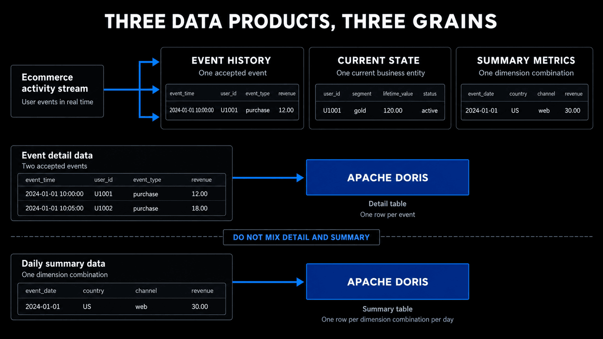
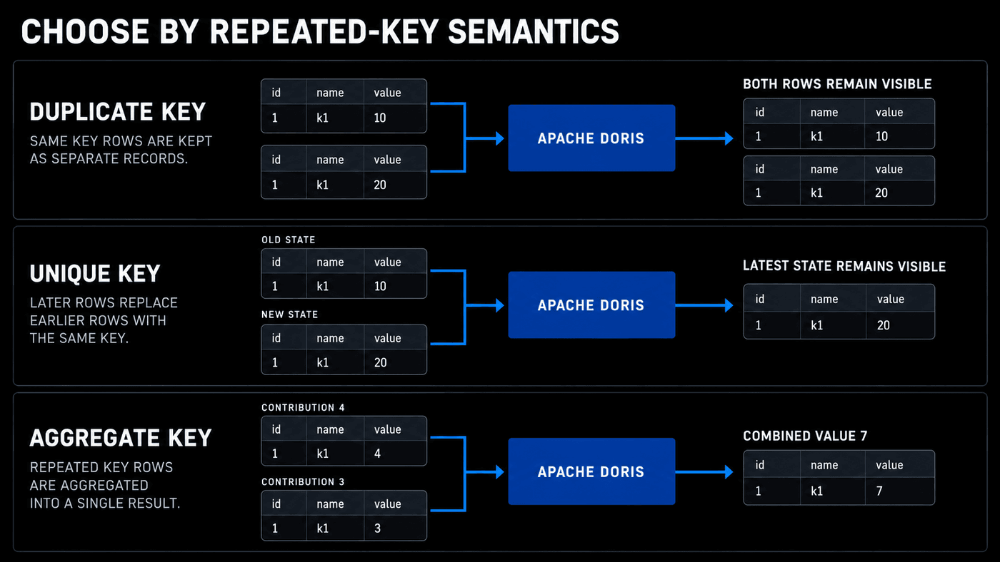
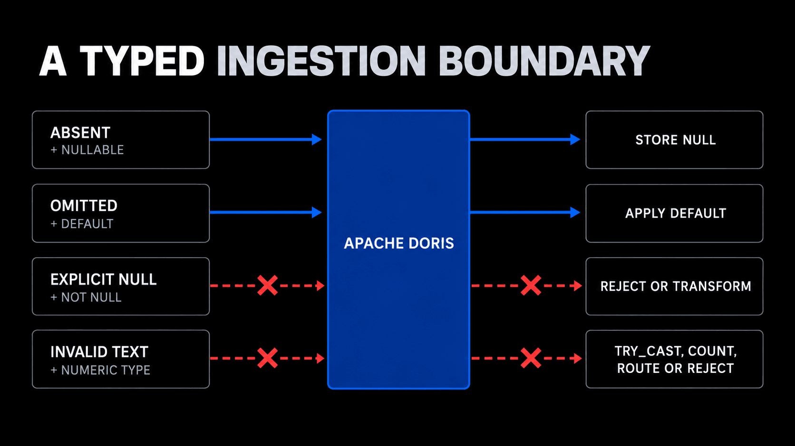
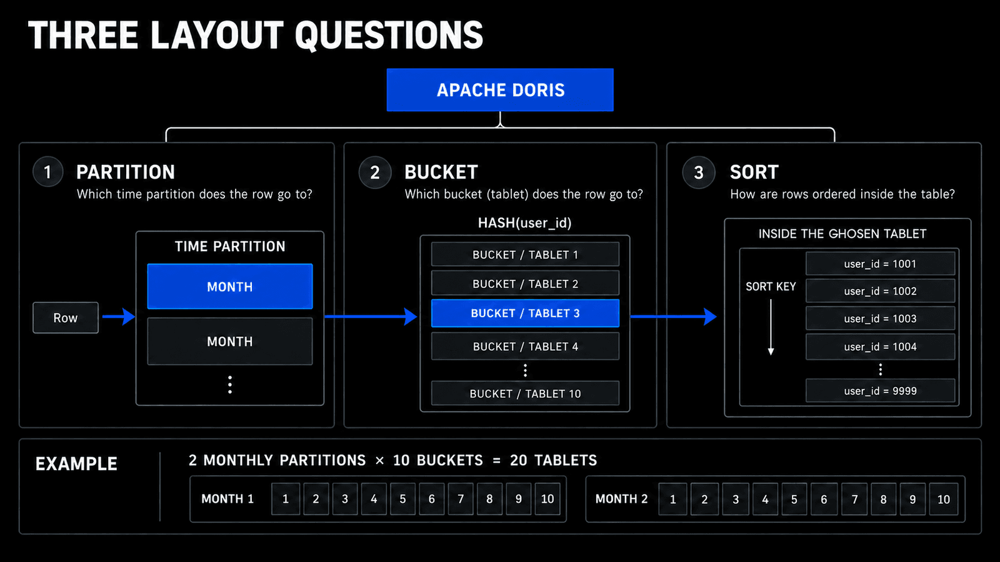

# Module 4: Modeling Data in Apache Doris

| Course information | Value |
| --- | --- |
| Course | Real-time Analytics with Apache Doris · Level 2 |
| Doris | Apache Doris 4.1.3 |
| Environment | The course sandbox and the `events` table from Lab 1 |
| Estimated time | About 90 minutes: reading 50, Lab 30, quiz 10 |

[Course README](../../README.md) · [Open Lab 4](lab04_model_data.ipynb) · [Open Quiz 4](quiz04_schema_and_modeling_choices.ipynb)

## Module goal

Turn the course's source events and its reporting needs into Doris tables:
decide what one row means, what a repeated key does, which types and missing
values each column allows, and how Partitions, Buckets, and the sort key lay
the rows out.

The scenario is an ecommerce analytics platform with three needs at once: it
keeps every browsing, cart, and purchase event; it exposes the current state
of changing entities such as orders; and it serves a dashboard at daily,
regional, and event-type grain. Lab 4 builds two of these data products,
`events_modelled` for event detail and `daily_event_metrics` for the daily
summary; Module 7 builds current state.

## Learning objectives

After completing this module, you will be able to:

1. Define a table's grain from its source contract, and keep detail and summary grains in separate tables.
2. Choose the Duplicate Key, Unique Key, or Aggregate Key model from the behavior that a repeated key requires.
3. Derive a summary's dimensions and additive measures from a reporting requirement, and reconcile it with the detail.
4. Choose types for identifiers, time, money, categories, and nested values from their meaning and the operations they need.
5. Distinguish `NULL`, `NOT NULL`, and `DEFAULT` for values that are missing, omitted, or invalid.
6. Design a table's Partitions, Buckets, and sort key from its time filters, lifecycle, distribution, and volume.

## Module structure

| Section | Time | Outcome |
| --- | ---: | --- |
| 4.1 Define What One Row Represents | 5 min | Give each data product one explicit grain |
| 4.2 Choose a Table Model from Repeated-Key Semantics | 6 min | Choose Duplicate, Unique, or Aggregate Key from what a repeated key must do |
| 4.3 Derive a Summary Model from the Reporting Requirement | 6 min | Store additive measures at a declared grain and reconcile them with the detail |
| 4.4 Choose Data Types from Business Meaning | 7 min | Choose identifier, time, money, and category types from their operations |
| 4.5 Give Missing, Omitted, and Invalid Values Different Rules | 6 min | Use nullability, defaults, and conversion checks for different states |
| 4.6 Choose Time Partitions from Query and Lifecycle Boundaries | 6 min | Choose a Partition grain and decide when Auto Partitioning fits |
| 4.7 Use Buckets to Distribute Data Within Every Partition | 5 min | Choose a Hash key and a Bucket count |
| 4.8 Align the Sort Key with the Main Access Path | 4 min | Start the sort key with the common range filter |
| 4.9 Map Complex Types from the Application Structure | 5 min | Choose `ARRAY`, `MAP`, `STRUCT`, `JSON`, or `VARIANT`, or ordinary columns |
| Lab 4 | 30 min | Build `events_modelled` and `daily_event_metrics` and reconcile them |
| Quiz 4 | 10 min | Six questions on these objectives |

## 4.1 Define What One Row Represents

Before naming columns, finish this sentence:

> One row in this table represents ...

That statement defines the table's **grain**. Grain comes from a business and
source contract. It is not discovered by choosing whichever column happens to
be unique in today's sample.

### Separate three common data products

The ecommerce platform needs three different row meanings:

| Data product | One row represents | Example question |
| --- | --- | --- |
| Event history | One accepted user or system event | Which purchases occurred between 09:00 and 10:00? |
| Current state | The currently visible state of one business entity | What is order 7842's current status and shipping address? |
| Summary metrics | One declared combination of reporting dimensions | How many purchase events occurred per date, region, and event type? |

These products may originate from the same activity, but they are not
interchangeable. Event history preserves the sequence and attributes of
individual observations. Current state intentionally hides superseded values
from an ordinary query. A summary intentionally removes dimensions and detail
that its reports do not need.

### Do not mix detail and summary grain

Suppose two purchase events have revenue 12.00 and 18.00. A daily summary for
those events contains revenue 30.00:



*Keep event history, current state, and summary metrics at separate declared grains.*

If all three rows are placed in one table and a query simply calculates
`SUM(revenue)`, the result is 60.00. The same activity has been represented once
as event detail and again as a summary. A row-type flag could let every query
filter one representation, but the table would still contain mixed grain and
make accidental double counting easy.

Keep the two grains in separate tables. Query event detail when the answer
needs users, products, timestamps, or individual events. Query the summary when
its declared dimensions and stored measures are sufficient.

### Use observations to verify a declared contract

A row count can confirm that the expected source is available. Distinct counts,
minimum and maximum values, and duplicate checks can reveal violations. They do
not replace the declared meaning of a row.

For example, a duplicated `event_id` may indicate bad source data, an event
identifier scoped to another field, or a legitimate repeated delivery. Only
the source contract says which interpretation is correct. Lab 4 therefore
confirms the baseline with `COUNT(*)` and reads its column metadata; the grain
itself comes from the contract.

## 4.2 Choose a Table Model from Repeated-Key Semantics

Module 2 (Deep Dive into Apache Doris Architecture) showed what each Table
Model does when a row arrives with a key that already exists: Duplicate Key
keeps both rows, Unique Key keeps the latest, and Aggregate Key combines the
value columns. Modeling asks the reverse question: which behavior does each
data product need?

| Data product | What a repeated key must do | Table Model |
| --- | --- | --- |
| Event history | Keep every accepted row | Duplicate Key |
| Current state | Replace the visible state of the business key | Unique Key |
| Summary metrics | Combine measure contributions per reporting key | Aggregate Key |

Choose the model from row meaning before thinking about performance. Doris
cannot convert an existing table to another Table Model; a changed contract
needs a new table and a controlled transition. See the [Table Model overview](https://doris.apache.org/docs/4.x/table-design/data-model/intro/)
and [Table Model best practices](https://doris.apache.org/docs/4.x/table-design/data-model/tips/).



*Choose a Table Model from the result that a repeated key must produce.*

### Event history: Duplicate Key

An event log keeps every accepted observation, even two events that share all
their key values. In this model the key columns set the sort key, so

```sql
DUPLICATE KEY(event_time, event_id, user_id)
```

does not mean "one row per `(event_time, event_id, user_id)`": the grain of
`events_modelled` stays one accepted source event. See the [Duplicate Key model](https://doris.apache.org/docs/4.x/table-design/data-model/duplicate/).

### Current state: Unique Key

An order-state table has a different contract:

| `order_id` | `status` | Meaning |
| ---: | --- | --- |
| 7842 | `paid` | Earlier accepted state |
| 7842 | `shipped` | New current state for the same order |

If ordinary queries should see one current row for `order_id = 7842`,
`order_id` is the Unique Key, and each new record for it is an upsert. Doris
4.x creates Unique Key tables with Merge-on-Write by default, so the write
itself makes the new state the visible one. Arrival order is not always
business order, because CDC events can arrive late or be retried: a Sequence
column lets a source version decide which state wins. Module 7 builds current
state with upserts, partial updates, Sequence columns, and deletes. See the
[Unique Key model](https://doris.apache.org/docs/4.x/table-design/data-model/unique/)
and [Merge-on-Write](https://doris.apache.org/docs/4.x/table-design/data-model/merge-on-write/).

### Summary metrics: Aggregate Key

A reporting pipeline may deliver several contributions for the same
`(event_date, region, event_type)`. If `event_count` and `total_revenue` should
be added, the dimensions are the Aggregate Key and the measures are value
columns declared `SUM`:

```text
(2026-09-15, east, purchase, event_count=4, total_revenue=90.00)
(2026-09-15, east, purchase, event_count=3, total_revenue=65.00)
                                      |
                                      v
one logical group representing event_count=7 and total_revenue=155.00
```

The key columns are both the aggregation group and the sort key, and each value
column declares how contributions merge. Such a table keeps no event
identifiers or timestamps, so it cannot replace the detail, and a contribution
that is loaded twice is added twice: retry safety still comes from the load
contracts of Module 3. See the [Aggregate Key model](https://doris.apache.org/docs/4.x/table-design/data-model/aggregate/).

## 4.3 Derive a Summary Model from the Reporting Requirement

The dashboard repeatedly needs daily event count and total revenue by region
and event type. Begin with that output, then derive the table contract.

### Define dimensions and measures separately

One summary row represents one:

```text
(event_date, region, event_type)
```

Those three dimensions become the Aggregate Key. The table stores two Value
columns:

- `event_count BIGINT SUM` represents the number of events contributing to the
  group.
- `total_revenue DECIMAL(18,2) SUM` represents their additive revenue.

`DECIMAL(18,2)` gives the accumulated summary more integral range than the
per-event `DECIMAL(12,2)` source. The required precision should follow expected
group size and revenue range rather than copying the detail type automatically.

The summary does not carry `event_id`, `user_id`, or `product_id`, because they
would change its grain. It therefore cannot answer which user purchased,
recover an individual event, or group accurately by product.

### Store only measures that combine correctly

Counts and revenue totals are additive across disjoint event contributions.
Several common metrics are not safely additive:

- A distinct-user count can count the same user in several batches or groups.
  An ordinary `SUM` of those counts overstates the union. A mergeable Bitmap or
  HyperLogLog (HLL) state may fit an approximate or exact distinct-count design,
  depending on the requirement.
- An average should not normally be added. Store a compatible numerator and
  denominator, then calculate the weighted result.
- Ratios and percentages generally need their underlying additive components.
- Minimum and maximum can merge with their matching aggregate semantics, but
  they do not behave like a sum.

The reporting question must identify how later batches and rollups combine.
Declaring `SUM` is a semantic promise, not just column syntax.

### Reconcile at the summary grain

`COUNT(*)` means different things in the two models:

| Table | `COUNT(*)` counts | Event population represented by one row |
| --- | --- | --- |
| `events_modelled` | Event-detail rows | One event |
| `daily_event_metrics` | Date-region-event type groups | `event_count` events |

Lab 4 sees 10,158,080 detail rows and 280 summary rows: 280 is the number of
summary groups that SQL returns.

Reconcile the models using measures that both can represent:

```text
COUNT(*) from events_modelled
        = SUM(event_count) from daily_event_metrics
        = 10,158,080 represented events

SUM(revenue) from events_modelled
        = SUM(total_revenue) from daily_event_metrics
        = 39,984,455.64 represented revenue
```

> **Evidence boundary:** matching totals verify the declared additive measures
> for this load. Lab 4 writes the summary with one pre-grouped insert, so the
> merge of separate batches is described here, not observed, and the Lab
> measures no speed.

## 4.4 Choose Data Types from Business Meaning

A data type should represent the valid domain of a field and support the
operations that matter. Choosing from the values visible in one file can
underestimate future range, precision, or structural needs.

Start with the required operations and correctness, then consider storage and
calculation cost:

| Business value and required behavior | Suitable starting type | Main tradeoff to evaluate |
| --- | --- | --- |
| Whole counts, quantities, or identifiers defined as numeric | The smallest integer type with safe future range | A narrower type uses less space, but an underestimated range can overflow |
| Money, account balances, tax rates, or another base-10 quantity requiring declared scale | `DECIMAL(p, s)` | Exact decimal behavior requires choosing sufficient precision and may use wider arithmetic as precision increases |
| Sensor measurements, scientific observations, coordinates, or model scores where approximation is acceptable | `FLOAT` or `DOUBLE` | Wide range and conventional floating-point computation come with representation error, non-associative aggregation, and unsuitable exact-equality semantics |
| Opaque identifiers or categorical labels | Bounded `VARCHAR` | Preserves formatting and nonnumeric identity but should not be used as a substitute for a number that every query must parse |
| Calendar date or event timestamp | `DATE` or `DATETIME(p)` | Precision and time-zone meaning must match the source and reporting boundaries |

`DOUBLE` arithmetic can be cheaper than wide `DECIMAL` arithmetic. That is a
performance question to measure on representative data, not a reason to store
money approximately: first decide whether approximation is valid at all.

### Keep identifiers consistent

An identifier may contain digits without being a quantity. Choose its type from
the source contract:

- Use an integer type when the identifier is defined as numeric, fits the
  selected range, and does not require formatting such as leading zeroes.
- Use a string type when letters, leading zeroes, composite formatting, or an
  external opaque convention belongs to the identity.

The same business Key should use compatible types in fact, dimension, and
state tables. Storing `product_id` as `BIGINT` in one table and as loosely
formatted text in another introduces repeated casts and can complicate Join
conditions. A cast in an occasional migration is normal; the same cast in
every production query signals an unresolved schema boundary.

### Represent time at the required precision

Use `DATE` when the value is a calendar date without time-of-day meaning. Use
`DATETIME` when the source and analysis require date and time. Doris supports
fractional-second precision in `DATETIME(p)`; choose `p` from the actual source
contract rather than inventing precision the source does not provide.

A temporal type does not define the business time zone. Document whether the
value represents Coordinated Universal Time (UTC), a local business zone, or
another convention. Daily boundaries are ambiguous until that convention is
known. See [DATETIME](https://doris.apache.org/docs/4.x/sql-manual/basic-element/sql-data-types/date-time/DATETIME/).

### Use exact fixed-point values for money and deliberate approximation for measurements

`DECIMAL(p, s)` gives an exact fixed-point contract:

- `p`, the precision, is the total number of significant decimal digits.
- `s`, the scale, is the number of digits after the decimal point.

For `DECIMAL(12,2)`, two digits belong to cents and the remaining capacity
supports the integral range. Choose enough precision for valid future values,
intermediate arithmetic, and required totals.

`FLOAT` and `DOUBLE` are approximate IEEE 754 binary floating-point types.
Choose them for values such as temperature, signal strength, coordinates, or a
statistical score only when small representation differences are acceptable.
`DOUBLE` provides more precision and range than `FLOAT`, but it still does not
represent every decimal fraction exactly. Floating-point addition is not
strictly associative, so distributed aggregation order can also expose small
differences. Avoid floating-point columns as exact Join Keys or equality-based
business identifiers.

For money, sufficiently large floating-point values can no longer represent
every cent. Text preserves characters but does not guarantee a valid amount and
forces conversion before numeric operations. Lab 4 makes both problems
observable: one text value fails conversion, and adding one cent to a large
`DOUBLE` does not produce the exact decimal result. See [DECIMAL](https://doris.apache.org/docs/4.x/sql-manual/basic-element/sql-data-types/numeric/DECIMAL/)
and [Floating-Point Types](https://doris.apache.org/docs/4.x/sql-manual/basic-element/sql-data-types/numeric/FLOATING-POINT/).

### Bound category strings without confusing two concepts

`event_type` and `region` are short categories, so bounded `VARCHAR` types
express their expected maximum length. String length and cardinality are
different:

- **Length** is the maximum number of characters or bytes required by one
  value's type contract.
- **Cardinality** is the number of distinct values appearing in the data.

A region can have low cardinality while each label still needs several
characters. An oversized `VARCHAR` does not create more category values, but it
weakens the contract and can increase unnecessary storage or processing costs.
Leave sensible headroom for controlled future values rather than using the
largest possible declaration by habit. See [VARCHAR](https://doris.apache.org/docs/4.x/sql-manual/basic-element/sql-data-types/string-type/VARCHAR/).

## 4.5 Give Missing, Omitted, and Invalid Values Different Rules

The following source conditions are not equivalent:

1. A product does not apply to an event.
2. A region was omitted and the business has agreed to classify it as
   `unknown`.
3. Revenue contains `not-a-number` and cannot satisfy the monetary contract.

One universal `NULL` or default rule would hide these differences.

### Choose nullability from allowed business states

Use a nullable column when absence is a valid state such as unknown, not yet
provided, or not applicable. Queries must then define how that state behaves in
filters, groups, counts, and Joins. For example, `COUNT(product_id)` ignores
`NULL`, while `COUNT(*)` still counts the event row.

Use `NOT NULL` when every accepted row must contain a valid value. This makes a
minimum data-quality requirement part of the table contract. Avoid declaring
every field nullable merely because a source parser can produce missing values.
That transfers unresolved decisions into every downstream query.

### Use `DEFAULT` only for an agreed omission rule

A default supplies a value when the target column is omitted from an insert.
For example:

```sql
region VARCHAR(16) NOT NULL DEFAULT "unknown"
```

supports a contract in which an omitted region belongs to the `unknown`
reporting category. It does not mean that an explicitly supplied `NULL` should
be silently converted, and it does not repair a malformed region value.

The distinction matters operationally:

| Input condition | Appropriate result for the lab contract |
| --- | --- |
| `product_id` is absent and absence is allowed | Store `NULL` in a nullable column |
| `region` is omitted and `unknown` is agreed | Omit the target column so its default applies |
| `region` is explicitly `NULL` in a `NOT NULL` column | Reject or transform before the insert according to the ingestion policy |
| Revenue text cannot become `DECIMAL(12,2)` | Count and route or reject the invalid row; do not treat it as valid missing revenue |

### Establish a typed ingestion boundary

`TRY_CAST` is useful when a landing table must preserve permissive source text.
It returns `NULL` when the conversion cannot be performed. That lets an
ingestion query count invalid rows before selecting valid typed values.

Do not calculate only
`SUM(TRY_CAST(revenue_text AS DECIMAL(12,2)))` and declare success. Aggregate
functions such as `SUM` ignore `NULL`, so malformed values could disappear from
the total. Pair the calculation with an invalid-row count and an explicit
policy. Once valid rows enter a typed analytical table, downstream queries can
use `SUM(revenue)` without repeating parsing logic. See [CAST and TRY_CAST](https://doris.apache.org/docs/4.x/sql-manual/basic-element/sql-data-types/conversion/cast-expr/).



*Treat missing, omitted, and invalid input as different states at the ingestion boundary.*

## 4.6 Choose Time Partitions from Query and Lifecycle Boundaries

Most event queries read recent time ranges, while retention, replacement, and
backfill operate on complete calendar periods. A Range Partition maps each row
to a declared value interval and gives Doris a data-management boundary inside
the table.

### Treat Partition as a value range that contains Tablets

Module 2 introduced the hierarchy: a rule such as `[2020-03-01, 2020-04-01)`
decides which rows belong to a Partition, and each Partition holds one Tablet
per Bucket. For `events_modelled`, the two levels answer different questions:

```text
events_modelled
    |
    +-- December 2019 Partition: which time range?
    |       +-- Tablet 1: which hash bucket?
    |       +-- ...
    |       +-- Tablet 10
    |
    +-- March 2020 Partition: which time range?
            +-- Tablet 1: which hash bucket?
            +-- ...
            +-- Tablet 10
```

The Partition is what a time filter lets the FE skip, and what retention or a
backfill drops or replaces as a whole. Module 2 measured the pruning, so Lab 4
only inspects the generated ranges.

### Choose a useful time grain

Partition granularity follows the workload:

- Daily Partitions can give fine lifecycle control but create more metadata and
  smaller physical units.
- Monthly Partitions reduce the number of Partition objects but make a whole
  month the natural lifecycle boundary.
- A very coarse Partition can contain too much data for precise retention or
  replacement work.

There is no universal day-or-month answer. Consider the amount of data per
period, common filter ranges, retention policy, backfill size, and expected
number of Partition objects.

### Use Auto Range Partitioning for rule-driven arrival

If new time values arrive continuously and their boundaries follow a stable
rule, Auto Range Partitioning can create the required Partition when data needs
it. The lab declaration uses:

```sql
AUTO PARTITION BY RANGE (date_trunc(event_time, 'month'))
```

The course data has events in December 2019 and March 2020, so Doris creates
those two monthly ranges; January and February have no events and get no
Partition.

Choose explicit Partition management when boundaries require advance approval,
special names, or a tightly controlled lifecycle process. Auto Partitioning
creates ranges; the Table Model, the grain, the Bucket key, and the sort key
remain your decisions. See [Auto Partitioning](https://doris.apache.org/docs/4.x/table-design/data-partitioning/auto-partitioning/).

## 4.7 Use Buckets to Distribute Data Within Every Partition

One monthly Partition can still contain millions of rows. Doris divides each
Partition into Buckets, each represented by a Tablet. Tablets are the physical
data shards distributed and processed by Backend (BE) nodes.

### Choose a Hash key that can spread the workload

With Hash distribution, Doris hashes the selected distribution columns to
choose a Bucket inside the row's Partition. The key should have enough distinct
and sufficiently distributed values for the workload.

The course data offers two candidates:

| Candidate | Data shape | Distribution consequence |
| --- | --- | --- |
| `region` | Eight synthetic values, each with about 1.27 million events | At most eight of a Partition's ten Buckets receive rows, and all of a region's rows in that Partition land in one Tablet, however much the region grows |
| `user_id` | About 1.58 million users across the event population | Hash values spread the rows over every Bucket |

This is why `events_modelled` uses `HASH(user_id)`. Hashing decides which
Bucket a key goes to; how many rows each Tablet gets still depends on how often
each key occurs. A key with
few values limits distribution even when those values are evenly used, as here;
skewed values make it worse, because the Buckets of the dominant values grow
fastest.

Random distribution can spread rows without preserving a key-based placement
relationship. In Doris 4.x it applies to Duplicate Key tables and to Aggregate
Key tables whose value columns do not use `REPLACE` or `REPLACE_IF_NOT_NULL`;
Unique Key tables, and Aggregate Key tables with such columns, must use Hash
distribution, and Doris rejects `DISTRIBUTED BY RANDOM` for them when the table
is created. Hash distribution is useful when stable placement by selected
columns benefits filtering or Join layouts. Module 6 explains how a compatible
distribution can help a Join; still choose the Hash key from the whole
workload and its skew, not from one future Join.

### Choose Bucket count as a capacity decision

Bucket count affects Tablet size, scheduling, and available parallel work:

- Too few Buckets can create very large Tablets and limit parallelism.
- Too many Buckets can create small Tablets and unnecessary metadata and
  scheduling overhead.

Consider rows and bytes per Partition, cluster size, expected growth,
concurrency, compaction pressure, and the useful degree of parallelism. Lab 4
uses ten Buckets because they fit the course data and keep the layout easy to
read.

For the observed table:

```text
2 generated Partitions × 10 Buckets per Partition = 20 Tablets
20 Tablets × 1 replica in the sandbox = 20 Tablet replicas
```

> **Evidence boundary:** the single-BE sandbox shows the Tablet count and how
> the rows are spread, not multi-node placement or parallel speed; Module 9
> runs a cluster with several BEs. See [Data Bucketing](https://doris.apache.org/docs/4.x/table-design/data-partitioning/data-bucketing/).

## 4.8 Align the Sort Key with the Main Access Path

Doris stores table data in the order defined by its Key columns. This ordering
supports prefix-based data access and compression behavior. The Table Model
determines what else those Key columns mean:

| Table Model | Additional Key responsibility |
| --- | --- |
| Duplicate Key | Sort rows; matching Keys do not imply uniqueness |
| Unique Key | Sort rows and identify the logical upsert Key |
| Aggregate Key | Sort rows and identify the aggregation group |

### Begin the event sort key with the common range filter

Most queries over `events_modelled` first restrict `event_time`. The sort key

```sql
DUPLICATE KEY(event_time, event_id, user_id)
```

therefore begins with time, followed by stable detail identifiers; in a
Duplicate Key table, these columns only order the rows.

Ordering should follow real access patterns, not an attempt to include every
possible filter column. A leading low-selectivity field can weaken the usefulness
of later fields for common predicates. Conversely, a field used only in rare
queries may not justify an early position.

### Keep the three layout questions separate

| Design layer | Question answered for an event row |
| --- | --- |
| Partition | Which time range contains the row? |
| Bucket / Tablet | Which shard inside that Partition receives the row? |
| Sort key | In what column order is data organized within the table's storage? |

The three choices cooperate, but each answers its own question: a sort key
creates no Partitions, a time Partition orders no rows, and a Hash key enforces
no uniqueness. Lab 4 inspects the declaration and the layout; Lab 2 compared the
scan work of two sort keys with the Query Profile.



*Partition selects the time range, Hash selects the Tablet, and the sort key orders data within storage.*

## 4.9 Map Complex Types from the Application Structure

Some attributes naturally belong inside one event row. Choose a complex type
from that structure and its analytical operations, not because the source is
nested or because one type appears more flexible.

| Application shape | Candidate Doris type | Example |
| --- | --- | --- |
| Ordered values of one element type | `ARRAY` | Tags or experiment identifiers attached to one event |
| Fixed named fields with known types | `STRUCT` | Device operating system, version, and form factor |
| Dynamic key-value attributes | `MAP` | Campaign properties whose names vary by event |
| JSON document retained and queried as JSON | `JSON` | A payload whose document structure must remain available |
| Evolving semi-structured document requiring flexible subfields | `VARIANT` | Partner events whose attributes change across producers |

An `ARRAY` preserves an ordered collection in one row; it does not represent
several independent event rows. A `STRUCT` fits a stable set of named child
fields. A `MAP` fits keys that vary while its key and value type contracts
remain meaningful. `JSON` and `VARIANT` support document-oriented and evolving
data, but flexibility does not remove the need for governance.

### Promote stable analytical fields

Fields used frequently for filtering, Partitioning, Bucketing, sorting, Joins,
grouping, or measures usually deserve ordinary typed columns. Keeping
`event_time`, `user_id`, `region`, and `revenue` buried inside a flexible payload
would force every query to recover the same contract.

Complex values work well for secondary attributes whose nested shape belongs
to a single row. Before production use, check the current Doris version for:

- supported nesting and element types;
- available access, transformation, and expansion functions;
- nullability and conversion behavior;
- restrictions on Key, Partition, distribution, index, and Join use;
- ingestion format and schema-evolution behavior.

These capabilities evolve. Use the application shape to select candidates,
then confirm syntax and restrictions in the current [ARRAY](https://doris.apache.org/docs/4.x/sql-manual/basic-element/sql-data-types/semi-structured/ARRAY/),
[MAP](https://doris.apache.org/docs/4.x/sql-manual/basic-element/sql-data-types/semi-structured/MAP/),
[STRUCT](https://doris.apache.org/docs/4.x/sql-manual/basic-element/sql-data-types/semi-structured/STRUCT/),
[JSON](https://doris.apache.org/docs/4.x/sql-manual/basic-element/sql-data-types/semi-structured/JSON/),
and [VARIANT](https://doris.apache.org/docs/4.x/sql-manual/basic-element/sql-data-types/semi-structured/VARIANT/)
documentation. Lab 4 does not create complex-type columns; Lab 5 uses a small
array literal to demonstrate row and element operations without changing the
event schema.

## Lab 4: Model Data for Analytical Workloads

Open [Lab 4 — Model Data for Analytical Workloads](lab04_model_data.ipynb) after
the Level 1 `events` baseline is available. Plan about 30 minutes. The Notebook
uses four Module 4 target tables and does not replace or delete the baseline:

- `modeling_raw_events` contains a five-row permissive landing sample.
- `modeling_typed_events` contains the four valid typed sample rows.
- `events_modelled` contains the complete event-detail model for Modules 5, 6,
  8, and 10.
- `daily_event_metrics` contains the daily reporting summary.

The five numbered lab steps provide these observations:

| Lab step | What you do | What the result establishes |
| --- | --- | --- |
| 1 | Confirm 10,158,080 baseline rows and inspect column metadata | The source is available and its stored types, nullability, and defaults can be checked; grain still comes from the source contract |
| 2 | Query text revenue with `TRY_CAST` and compare `DOUBLE` with `DECIMAL` | A permissive string accepts an invalid amount; failed conversion needs a separate count; approximate arithmetic can lose cent-level precision |
| 3 | Insert valid values through a typed boundary | Four rows remain, one omitted region receives `unknown`, one valid product remains `NULL`, and revenue totals 39.94 |
| 4 | Build and inspect `events_modelled` | Duplicate Key preserves 10,158,080 events; two monthly Partitions each contain 10 Hash Buckets, producing 20 Tablets in this sandbox |
| 5 | Build and reconcile `daily_event_metrics` | 280 visible groups represent all 10,158,080 events and the same 39,984,455.64 revenue |

In Step 4, the two generated Partitions reflect only source months that occur:
December 2019 and March 2020; January and February have no events, so Auto
Partitioning created no ranges for them. The Tablet summary is metadata about
the current layout.

In Step 5, distinguish three quantities:

- `stored_rows` from `COUNT(*)` is the number of SQL-visible logical rows in
  each table.
- `represented_event_rows` is one per detail row but comes from
  `SUM(event_count)` for the summary.
- `represented_revenue` comes from the compatible revenue measure in each
  grain.

Run the optional stop and restart cells only when you want to release and then
restore sandbox resources. Docker named volumes preserve the baseline and Lab
4 tables. `events_modelled` must remain available for Modules 5, 6, 8, and 10.

The Lab ends with a practice: reconcile one day of the summary with the detail.
Predict the result first, then write the code in the empty cell; the collapsed
reference solution after it also runs with Run All and leaves the Lab's tables
as they were.

## Summary

- A table's grain comes from its source contract: one accepted event, one
  current entity, or one declared group of dimensions. Detail and summary rows
  belong in separate tables, or a `SUM` counts the same activity twice.
- The Duplicate Key model keeps every accepted row, the Unique Key model
  exposes one current row per key, and the Aggregate Key model combines value
  columns with their declared function; the key columns also form the sort
  key.
- A summary declares its dimensions as Aggregate Key columns and stores only
  measures that combine correctly, such as counts and totals;
  `daily_event_metrics` represents all 10,158,080 events and 39,984,455.64 in
  280 rows.
- Types follow meaning: integers or strings for identifiers, `DATE` or
  `DATETIME` for time, `DECIMAL` for money, bounded `VARCHAR` for categories,
  and complex types only for attributes whose nested shape belongs to one row.
- `NULL` is a valid absence in a nullable column, `NOT NULL` makes a value
  required, `DEFAULT` applies only when a column is omitted, and a value that
  cannot convert is invalid and needs its own count and policy.
- Partitions follow time filters and the lifecycle, Hash Buckets on a key with
  many values spread each Partition over Tablets, and the sort key starts with
  the common range filter; Lab 4's two monthly Partitions with ten Buckets give
  20 Tablets.

## Quiz 4: Modeling Data in Apache Doris

Open [Quiz 4: Modeling Data in Apache Doris](quiz04_schema_and_modeling_choices.ipynb).
It has six single-choice questions and needs no running environment.

Next module: [Module 5: Analyzing Data in Apache Doris](../module05-analyzing/course.md).

## References

- Table design workflow: [Table Design Guide](https://doris.apache.org/docs/4.x/table-design/overview/) and [Table Model Best Practices](https://doris.apache.org/docs/4.x/table-design/data-model/tips/).
- Repeated-Key semantics: [Table Model Overview](https://doris.apache.org/docs/4.x/table-design/data-model/intro/), [Duplicate Key](https://doris.apache.org/docs/4.x/table-design/data-model/duplicate/), [Unique Key](https://doris.apache.org/docs/4.x/table-design/data-model/unique/), [Merge-on-Write](https://doris.apache.org/docs/4.x/table-design/data-model/merge-on-write/), and [Aggregate Key](https://doris.apache.org/docs/4.x/table-design/data-model/aggregate/).
- Doris 4.1.3 implementation terminology: [`KeysType.java`](https://github.com/apache/doris/blob/4.1.3/fe/fe-core/src/main/java/org/apache/doris/catalog/KeysType.java) maps the model types to `DUPLICATE KEY`, `UNIQUE KEY`, and `AGGREGATE KEY`; [`AggregateType.java`](https://github.com/apache/doris/blob/4.1.3/fe/fe-core/src/main/java/org/apache/doris/catalog/AggregateType.java) defines supported stored aggregation types such as `SUM`, `MIN`, `MAX`, `BITMAP_UNION`, and `HLL_UNION`.
- Column contracts: [Data Types](https://doris.apache.org/docs/4.x/table-design/data-type/), [DECIMAL](https://doris.apache.org/docs/4.x/sql-manual/basic-element/sql-data-types/numeric/DECIMAL/), [DATETIME](https://doris.apache.org/docs/4.x/sql-manual/basic-element/sql-data-types/date-time/DATETIME/), [VARCHAR](https://doris.apache.org/docs/4.x/sql-manual/basic-element/sql-data-types/string-type/VARCHAR/), and [CAST and TRY_CAST](https://doris.apache.org/docs/4.x/sql-manual/basic-element/sql-data-types/conversion/cast-expr/).
- Physical design: [CREATE TABLE](https://doris.apache.org/docs/4.x/sql-manual/sql-statements/table-and-view/table/CREATE-TABLE/), [Auto Partitioning](https://doris.apache.org/docs/4.x/table-design/data-partitioning/auto-partitioning/), and [Data Bucketing](https://doris.apache.org/docs/4.x/table-design/data-partitioning/data-bucketing/).
- Complex types: [ARRAY](https://doris.apache.org/docs/4.x/sql-manual/basic-element/sql-data-types/semi-structured/ARRAY/), [MAP](https://doris.apache.org/docs/4.x/sql-manual/basic-element/sql-data-types/semi-structured/MAP/), [STRUCT](https://doris.apache.org/docs/4.x/sql-manual/basic-element/sql-data-types/semi-structured/STRUCT/), [JSON](https://doris.apache.org/docs/4.x/sql-manual/basic-element/sql-data-types/semi-structured/JSON/), and [VARIANT](https://doris.apache.org/docs/4.x/sql-manual/basic-element/sql-data-types/semi-structured/VARIANT/).
