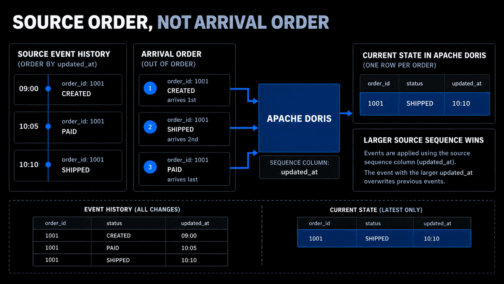
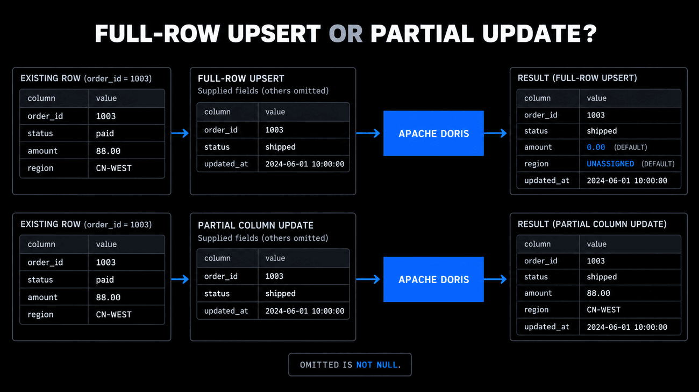
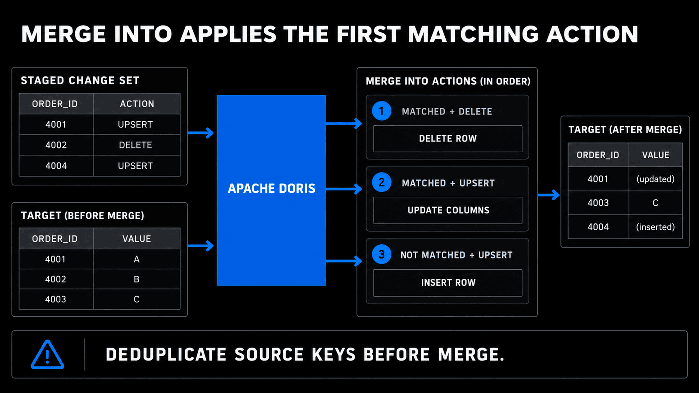
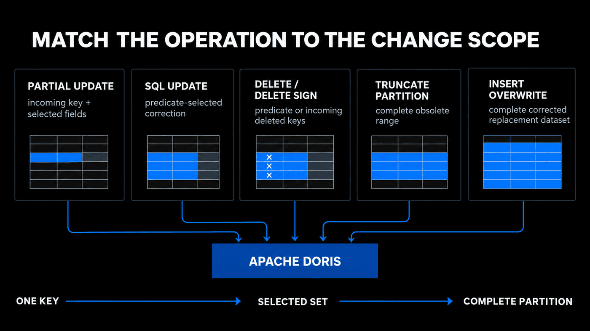
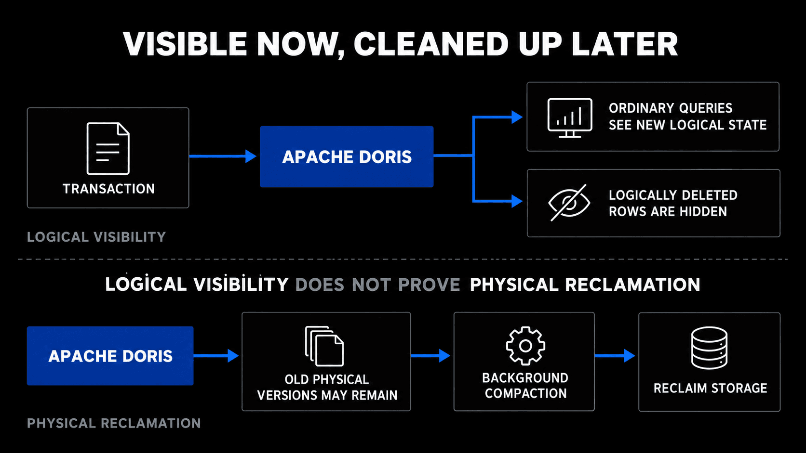

# Module 7: Updating and Deleting Data in Apache Doris

| Course information | Value |
| --- | --- |
| Course | Real-time Analytics with Apache Doris · Level 2 |
| Doris | Apache Doris 4.1.3 |
| Environment | The course sandbox from Lab 1 |
| Estimated time | About 65 minutes: reading 30, Lab 25, quiz 10 |

[Course README](../../README.md) · [Open Lab 7](lab07_update_delete_data.ipynb) · [Open Quiz 7](quiz07_state_changes_and_deletion.ipynb)

## Module goal

Keep the current state of changing business entities correct in Doris: choose
the operation from how changes arrive, and check what a query sees after each
one.

Modules 4 to 6 worked on the event history, which only grows: an event that
happened is never updated, and the 10,158,080 rows of `events_modelled` stay as
they are. Updates and deletes belong to tables that hold a current state, such
as orders whose status changes. This module therefore leaves the events alone
and uses small order tables with a few rows each, so that you can see what
every operation does to every row: an order platform sends complete order
images, logistics patches, corrections, and deletion records, and a daily
Partition can expire or need a full backfill.

## Learning objectives

After completing this module, you will be able to:

1. Choose full-row upsert, partial column update, SQL `UPDATE`, or `MERGE INTO` from the form and ownership of incoming changes.
2. Use a Sequence column so that source order, not arrival order, decides which state wins.
3. Predict what full-row and partial writes do to omitted columns, and how omission differs from `NULL`.
4. Choose predicate `DELETE` or the Delete Sign from how the deleted rows are identified.
5. Choose `TRUNCATE` or `INSERT OVERWRITE` to remove or replace a complete Partition.
6. Separate the visibility of a published change from the later physical cleanup by Compaction.

## Module structure

| Section | Time | Outcome |
| --- | ---: | --- |
| 7.1 Define the State Contract Before Choosing an Operation | 4 min | Separate history from current state, and each Table Model's role |
| 7.2 Synchronize Complete States with Unique Key Upsert | 4 min | Upsert complete states and let a Sequence column order them |
| 7.3 Preserve Unowned Fields with Partial Column Update | 5 min | Patch some columns and keep the others |
| 7.4 Correct a Small Selected Set with SQL UPDATE | 3 min | Correct the rows that a predicate selects |
| 7.5 Apply Conditional Actions with MERGE INTO | 5 min | Update, delete, and insert from one staged change set |
| 7.6 Choose How Deleted Rows Are Identified | 3 min | Delete by predicate or by incoming keys |
| 7.7 Match the Operation to a Complete Lifecycle Scope | 3 min | Truncate or overwrite a whole Partition |
| 7.8 Separate Logical Visibility from Physical Cleanup | 3 min | Read what queries, hidden markers, and metadata show |
| Lab 7 | 25 min | Upsert, patch, correct, merge, delete, and replace on small order tables |
| Quiz 7 | 10 min | Six questions on these objectives |

## 7.1 Define the State Contract Before Choosing an Operation

An event-history table answers **what happened**. A current-state table answers
**what is true now**. An order moving from `created` to `paid` to `shipped` can
produce three history events but one current order row.

| Table Model | Another row with the same Key means | Change-processing role |
| --- | --- | --- |
| Duplicate Key | Preserve another accepted row | History and audit data; another insert does not hide the old row |
| Unique Key | Replace the visible state for that business Key | Current state and primary-key synchronization |
| Aggregate Key | Combine Value columns through declared aggregate functions | Metric contributions or specialized replacement aggregates |

Unique Key is central because full-row upsert, Sequence ordering, SQL `UPDATE`,
Delete Sign, and `MERGE INTO` serve primary-key state maintenance. This does not
make every deletion Unique-only. Predicate `DELETE` can apply across models with
model-specific restrictions, while whole-Partition operations have a different
scope. Aggregate Key can use specialized patterns such as
`REPLACE_IF_NOT_NULL`; that is aggregate-model behavior, not the order-state
contract used here.

Before writing, ask:

1. Which business Key identifies the target state?
2. Does the source carry a full row, selected fields, a predicate, or a complete
   replacement dataset?
3. Which source value establishes order?
4. Can several source rows target the same Key in one batch?
5. Is the scope one Key, a selected set, one Partition, or the table?

## 7.2 Synchronize Complete States with Unique Key Upsert

When a source emits a complete current image, loading into a Unique Key table
provides upsert behavior:

```text
new Key       -> insert a current row
existing Key  -> replace its visible current state
```

This fits batched full images from CDC or a producer that owns every target
Value column. It does not preserve every historical version in ordinary query
results.

### Make source order explicit

Arrival order is unreliable. A delayed `paid` message can arrive after a newer
`shipped` message. A Sequence column makes source version, timestamp, or offset
part of the table contract:



*Current state follows the authoritative source sequence, not arrival order.*

Lab 7 declares `"function_column.sequence_col" = "updated_at"`. Merely naming a
column `updated_at` would not create ordering semantics. Choose a value monotonic
for each business Key and supplied by the authoritative source. Equal Sequence
values need an additional source policy; do not assume arrival order is a safe
tie-breaker.

Continuous changes should normally be batched. A tight loop of individual
writes creates many transactions and storage versions. Freshness, batch size,
failure recovery, and retry safety remain part of the ingestion contract.

## 7.3 Preserve Unowned Fields with Partial Column Update

A logistics feed may own `status` and `updated_at` but not `amount` or
`shipping_region`. Reconstructing a complete row could overwrite other systems'
values.

| Mode | Existing Key receives only status and time | Omitted Value columns |
| --- | --- | --- |
| Full-row upsert | Construct a complete replacement | Use schema defaults or permitted `NULL` |
| Partial column update | Patch the existing state | Preserve visible values |



*Omitted columns are replaced by a full-row upsert but preserved by a partial update.*

Lab 7 shows a full-row write changing omitted amount and region to `0.00` and
`UNASSIGNED`, while a partial update preserves `88.00` and `CN-WEST`.

Omission is different from explicitly supplying `NULL`. An explicit `NULL` is
a requested value for a nullable column and is invalid for a `NOT NULL` column
unless transformed before the write. A default is not a universal repair for a
supplied invalid value.

### Turn on partial updates for SQL or for a load

Partial column update works on Unique Key tables with Merge-on-Write, the 4.x
default. It is off unless the write asks for it, and the two common paths ask
differently:

- **`INSERT INTO` with a column list.** Without a setting, an `INSERT` that
  names only some columns is still a full-row upsert. Set the session variable
  `enable_unique_key_partial_update` to `true` first; Lab 7 does this and sets
  it back afterwards:

  ```sql
  SET enable_unique_key_partial_update = true;
  INSERT INTO order_state (order_id, status, updated_at)
  VALUES (1003, 'shipped', '2026-09-12 10:30:00');
  ```

- **Stream Load.** Send the header `partial_columns:true` and list the columns
  in the file with the `columns` header; Broker Load and Routine Load take the
  same property:

  ```bash
  curl --location-trusted -u root: \
    -H "Expect:100-continue" \
    -H "partial_columns:true" \
    -H "column_separator:," \
    -H "columns:order_id,status" \
    -T status_patch.csv \
    -X PUT http://127.0.0.1:18030/api/doris_course/order_state/_stream_load
  ```

Every row must carry all the Key columns, so that Doris can find the row to
patch, and all the rows of one write update the same set of columns. A row
whose key does not exist yet has no old values to keep: by default
(`partial_update_new_key_behavior = APPEND`) Doris inserts it and fills the
other columns with their defaults or `NULL`, and fails the write if a `NOT
NULL` column has no default. Set the variable, or the load property of the same
name, to `ERROR` when a patch must never create an order; the write then fails
with "Can't append new rows in partial update". The [Column Update](https://doris.apache.org/docs/4.x/data-operate/update/partial-column-update/)
page also covers flexible column updates, in which each JSON row of a load can
patch different columns.

## 7.4 Correct a Small Selected Set with SQL UPDATE

When no replacement records exist and a SQL predicate identifies the problem,
use a direct correction:

```sql
UPDATE order_state
SET shipping_region = 'CN-NORTH'
WHERE order_id = 1001;
```

`WHERE` selects target rows; `SET` names changed Value columns. SQL `UPDATE`
targets a Unique Key table and cannot modify Key columns. A business-Key change
should delete the old Key and insert the new one.

This path fits occasional corrections. It is a poor shape for a high-frequency
application loop because each statement finds rows and publishes a transaction.
When incoming records already identify Keys, use batched full-row or partial
loads.

## 7.5 Apply Conditional Actions with MERGE INTO

A staging relation may contain mixed change types:

| `order_id` | `change_type` | Required action |
| ---: | --- | --- |
| 4001 | UPSERT | Update an existing order |
| 4002 | DELETE | Delete an existing order |
| 4004 | UPSERT | Insert a new order |



*`MERGE INTO` applies the first qualifying action and leaves target-only rows unchanged.*

`MERGE INTO` joins that relation to a target table, which must be a Unique Key
table with Merge-on-Write; on any other table Doris rejects the statement
("merge into command only support MOW unique key olapTable"):

```sql
MERGE INTO order_merge_target AS t
USING order_merge_changes AS s
ON t.order_id = s.order_id
WHEN MATCHED AND s.change_type = 'DELETE' THEN DELETE
WHEN MATCHED AND s.change_type = 'UPSERT' THEN UPDATE SET
    status = s.status,
    amount = s.amount,
    shipping_region = s.shipping_region,
    updated_at = s.updated_at
WHEN NOT MATCHED AND s.change_type = 'UPSERT' THEN INSERT
    (order_id, status, amount, shipping_region, updated_at)
VALUES
    (s.order_id, s.status, s.amount, s.shipping_region, s.updated_at);
```

Doris evaluates the `WHEN` clauses in order and applies the first one whose
condition holds:

- `WHEN MATCHED` clauses handle source rows whose key exists in the target;
  each one either updates the named columns, with values from the source or
  the target, or deletes the row.
- `WHEN NOT MATCHED` clauses handle source rows without a target row; each one
  inserts a new row from the source's values.
- A clause without an `AND` condition must be the last of its kind, because
  any clause after it could never run.

A target row without a source row is left alone: in the Lab, order 4003 is
in the target but not in the change set, so it keeps its state. Running the statement needs
`SELECT_PRIV` on the target and the source, and `LOAD_PRIV` on the target.

This fits a set-based batch already represented as a table or subquery. It adds
conditional matched and not-matched actions that a simple upsert cannot express.
It is a Data Manipulation Language statement, not a substitute for a continuous
high-throughput streaming load.

### Require deterministic source matching

Doris 4.x does not detect when several source rows match the same target row.
If they do, the result is undefined: as with an `INSERT`, a Sequence column
decides which write wins, and without one any of them may. Deduplicate the
batch by an authoritative sequence, or reject it, before the merge. Lab 7
compares the number of source rows with the number of distinct source keys
before it runs the statement.

## 7.6 Choose How Deleted Rows Are Identified

Use predicate `DELETE` when SQL defines the target set, such as
`status = 'test'`. It can apply to Duplicate, Unique, and Aggregate Key tables,
although Aggregate Key delete conditions are restricted to Key columns.

Use Delete Sign when a batch or CDC record already carries a deleted Unique
Key. Setting hidden `__DORIS_DELETE_SIGN__ = 1` lets deleted Keys use a load
path. Writing `NULL`, omitting Value columns, or sending an ordinary upsert does
not mean delete.

Delete Sign is an input-facing hidden column, not the internal per-Rowset delete
bitmap described by Merge-on-Write. Lab 7 deletes `2003` by predicate and
`2002` by Delete Sign, after which an ordinary query returns only `2001`.

## 7.7 Match the Operation to a Complete Lifecycle Scope



*Choose an operation whose scope matches the incoming change, from one Key to a complete Partition.*

| Requirement | Starting operation |
| --- | --- |
| A complete table or Partition is obsolete | `TRUNCATE TABLE/PARTITION` |
| A complete corrected dataset replaces a scope | `INSERT OVERWRITE` |
| Only a bounded predicate-selected set disappears | Predicate `DELETE` |

`TRUNCATE PARTITION` fits retention of complete calendar ranges.
`INSERT OVERWRITE` fits a backfill containing the complete desired contents;
rows absent from the replacement do not remain. Ordinary `INSERT INTO` on a
Duplicate Key table would append and can duplicate the old scope.

Doris documents overwrite as atomic replacement. Lab 7 observes the final
contents but does not run concurrent readers, so it does not claim to observe
the switch itself. Always verify the target scope: a complete dataset written
to the wrong Partition is still a complete replacement of the wrong data.

## 7.8 Separate Logical Visibility from Physical Cleanup

After publication, new ordinary queries see the winning Unique Key state and
exclude logically deleted rows. They need not wait for Compaction. Superseded
physical versions can remain until background Compaction reclaims them.



*Logical visibility is immediate after publication; physical reclamation is later background work.*

| Evidence | Supported conclusion | Unsupported conclusion |
| --- | --- | --- |
| Ordinary `SELECT` | Current visible rows and values | Whether old bytes were reclaimed |
| Hidden Delete Sign | Current hidden delete markers | Internal delete-bitmap contents |
| `SHOW TABLETS` versions | A later Tablet version was published | Exact visible row count or future version count |
| Official documentation | Designed MoW and Compaction behavior | Direct Notebook observation of internals |

`VersionCount` can change during the lab because background work is independent.
Tablet `RowCount` is not `COUNT(*)`. Frequent tiny writes can also create
transaction, version, and Rowset pressure, so batch continuous changes and use
Partition-level operations for whole ranges.

## Lab 7: Maintain Current State and Remove Data Safely

Open [Lab 7 — Maintain Current State and Remove Data Safely](lab07_update_delete_data.ipynb)
and plan about 25 minutes. It needs only the course sandbox and creates only
Module 7 tables:

- `order_state` for upsert, Sequence, partial update, and SQL correction;
- `order_merge_target` and `order_merge_changes` for local `MERGE INTO`;
- `order_deletions` for predicate DELETE and Delete Sign;
- `order_lifecycle` for Partition truncate and overwrite.

| Step | Observation |
| --- | --- |
| 1 | New and existing Keys follow upsert; the larger Sequence wins |
| 2 | Full-row omission uses defaults; partial update preserves values |
| 3 | SQL `UPDATE` changes only the selected Value column |
| 4 | One merge performs matched update, matched delete, and not-matched insert |
| 5 | Predicate and incoming-Key deletes produce the intended visible state |
| 6 | Truncate removes an expired range and overwrite replaces a backfill scope |

No external CDC system, object store, or downloaded dataset is involved.

The Lab ends with a practice: patch orders through a partial-update Stream Load.
Predict the result first, then write the code in the empty cell; the collapsed
reference solution after it also runs with Run All and leaves the Lab's tables
as they were.

## Summary

- Choose the change path from the source: full-row upsert for complete states,
  partial column update for patches that own some columns, SQL `UPDATE` for an
  occasional correction selected by a predicate, and `MERGE INTO` for a staged
  set that needs updates, deletes, and inserts together.
- A Sequence column makes the source's version decide which state of a key
  wins, so a delayed older state does not replace a newer one.
- A full-row upsert fills omitted value columns from their defaults or `NULL`;
  a partial column update keeps their existing values; and an explicit `NULL`
  is a value, not an omission.
- Predicate `DELETE` removes the rows that a SQL condition selects; the Delete
  Sign deletes keys that arrive as data, for example from CDC.
- `TRUNCATE` removes a complete table or Partition, and `INSERT OVERWRITE`
  replaces a complete scope with corrected data in one atomic switch.
- After a change is published, new queries see the new state at once, while
  old physical versions can remain until background Compaction reclaims them.

## Quiz 7: Updating and Deleting Data in Apache Doris

Open [Quiz 7: Updating and Deleting Data in Apache Doris](quiz07_state_changes_and_deletion.ipynb).
It has six single-choice questions and needs no running environment.

Next: this is the last module of Level 2. Level 3 starts with [Module 8: Accelerating Queries in Apache Doris](../../level3/module08-query-acceleration/course.md).

## References

- [Data Update and Delete](https://doris.apache.org/docs/4.x/key-features/data-update-delete/) and [Unique Key](https://doris.apache.org/docs/4.x/key-features/unique-key/)
- [Load-Based Updates for the Unique Model](https://doris.apache.org/docs/4.x/data-operate/update/update-of-unique-model/) and [Column Update](https://doris.apache.org/docs/4.x/data-operate/update/partial-column-update/)
- [`UPDATE`](https://doris.apache.org/docs/4.x/sql-manual/sql-statements/data-modification/DML/UPDATE/) and [`MERGE INTO`](https://doris.apache.org/docs/4.x/sql-manual/sql-statements/data-modification/DML/MERGE-INTO/)
- [Delete Operation](https://doris.apache.org/docs/4.x/data-operate/delete/delete-manual/) and [Load-Based Batch Delete](https://doris.apache.org/docs/4.x/data-operate/delete/batch-delete-manual/)
- [Truncate Operation](https://doris.apache.org/docs/4.x/data-operate/delete/truncate-manual/) and [`INSERT OVERWRITE`](https://doris.apache.org/docs/4.x/sql-manual/sql-statements/data-modification/DML/INSERT-OVERWRITE/)
- Doris 4.1.3 terminology: [`OlapTable.java`](https://github.com/apache/doris/blob/4.1.3/fe/fe-core/src/main/java/org/apache/doris/catalog/OlapTable.java) and [`InternalCatalog.java`](https://github.com/apache/doris/blob/4.1.3/fe/fe-core/src/main/java/org/apache/doris/datasource/InternalCatalog.java)
