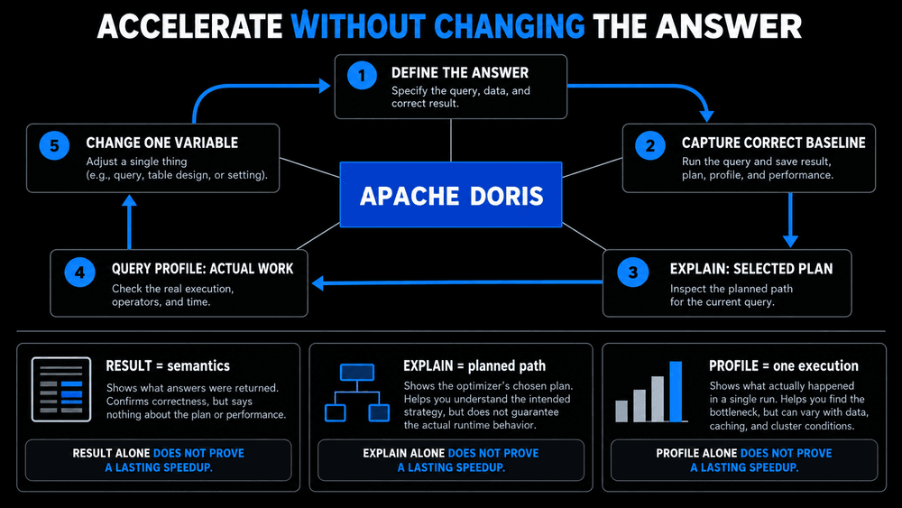
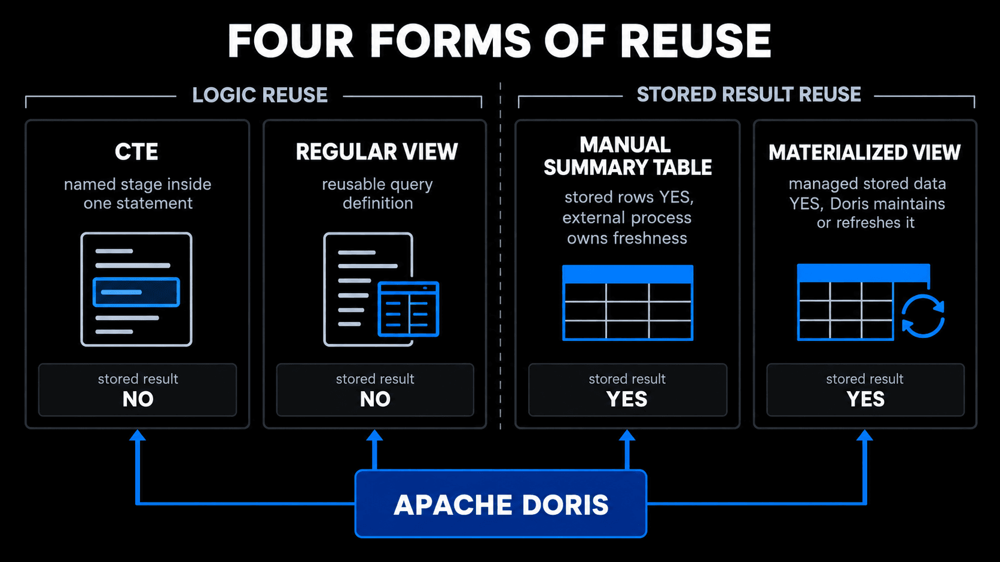
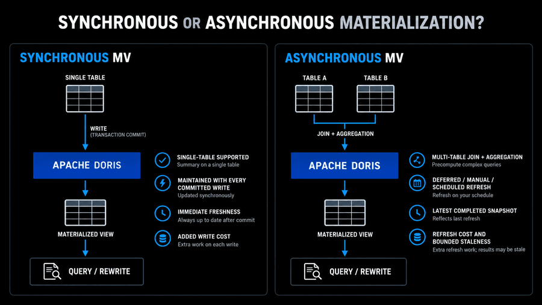
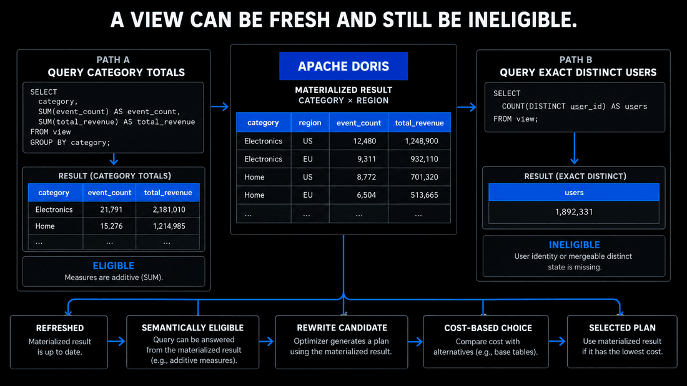
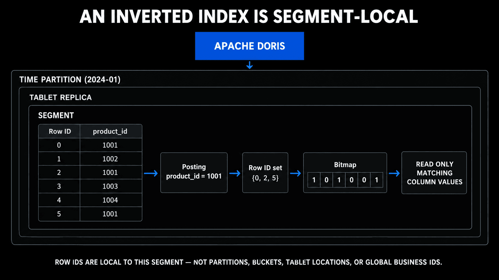

# Module 8: Accelerating Queries in Apache Doris

| Course information | Value |
| --- | --- |
| Course | Real-time Analytics with Apache Doris · Level 3 |
| Doris | Apache Doris 4.1.3 |
| Environment | The course sandbox, `events_modelled` from Lab 4, and `dim_products` from Lab 6 |
| Estimated time | About 120 minutes: reading 55, Lab 55, quiz 10 |

[Course README](../../README.md) · [Open Lab 8](lab08_accelerate_queries.ipynb) · [Open Quiz 8](quiz08_acceleration_choices.ipynb)

## Module goal

Reduce the repeated work of queries without changing their answers: choose a
view, a materialized view, or an index from the query's shape, freshness, and
cost, and check each one with the result, the plan, and the Query Profile.

An ecommerce analytics team already has a correct regional revenue dashboard,
but the workload is changing: more reports reuse its purchase definition, the
same aggregations run more often, category analysis adds a product Join, and
investigators look up the events of single products. Each section takes one of
these changes and asks which repeated work Doris should avoid. A correct
result establishes the semantics, `EXPLAIN` establishes the selected plan, and
a Query Profile establishes what one execution scanned; none of them alone
proves a lasting speedup.

## Learning objectives

After completing this module, you will be able to:

1. Distinguish a regular view, a manually populated summary table, a synchronous materialized view, and an asynchronous materialized view.
2. Choose synchronous or asynchronous materialization from the SQL scope, the freshness requirement, and the write or refresh cost.
3. Determine whether a materialized result preserves the dimensions and measure state needed to answer another query.
4. Choose an inverted index, a BloomFilter index, or an NGram BloomFilter index from the predicate it must serve.
5. Separate build state, plan selection, statistics, and runtime evidence when you check an acceleration structure.
6. Decide whether the read savings of a structure justify its storage, write, and refresh cost.

## Module structure

| Section | Time | Outcome |
| --- | ---: | --- |
| 8.1 Define the Answer Before Reducing the Work | 6 min | Fix the population and grain, and separate result, plan, and runtime evidence |
| 8.2 Reuse Query Logic with a Regular View | 5 min | Reuse a definition without claiming a stored result |
| 8.3 Keep a Supported Single-Table Summary Current | 8 min | Use a synchronous materialized view within its scope |
| 8.4 Store a Multi-Table Result with an Asynchronous Materialized View | 8 min | Store a Join result and define its refresh and freshness |
| 8.5 Decide Whether a Materialized Result Can Answer the Query | 7 min | Check dimensions, grain, and measure state before expecting a rewrite |
| 8.6 Narrow Selective Detail Lookups with a Secondary Index | 9 min | Choose an index from the predicate, and test it fairly |
| 8.7 Give the Optimizer Reliable Inputs | 6 min | Check eligibility, state, and statistics before forcing a plan |
| 8.8 Decide Whether the Read Savings Justify the Cost | 6 min | Weigh read savings against storage, write, and refresh cost |
| Lab 8 | 55 min | Build a view, two materialized views, and an index, and read statistics and plans |
| Quiz 8 | 10 min | Six questions on these objectives |

## 8.1 Define the Answer Before Reducing the Work

The regional revenue dashboard is already producing an accepted answer, but
its execution cost is rising as usage grows. The team should not choose a view
or index until it can state which answer must remain unchanged and which work
it wants to reduce.

An acceleration structure is useful only when it preserves that intended
answer. Begin with a query contract:

| Contract question | Example answer |
| --- | --- |
| What rows are eligible? | Purchase events in the selected time range |
| What does one output row represent? | One region or one product category |
| Which measures are required? | Event count and exact revenue total |
| How fresh must the result be? | Every committed write, or the latest completed refresh |
| How often is the query executed? | Repeated dashboard request or occasional investigation |
| Which resources are constrained? | Scan work, Join work, storage, load capacity, or refresh capacity |

### Keep the population explicit

Two valid reports can use different populations. A regional report may read
purchase events directly, while a category report may use an Inner Join to a
product dimension. Events whose product does not match the dimension remain in
the first population and disappear from the second.

That difference is Join semantics. It is not evidence that a view, materialized
view, or index lost data. Before comparing an accelerated result with a
baseline, confirm that both queries use the same:

- source relations;
- Join type and Join condition;
- row filters;
- grouping dimensions;
- measure definitions; and
- `NULL` handling.

### Separate three kinds of evidence

| Evidence | Question answered | Question not answered |
| --- | --- | --- |
| Complete query result | Did this SQL return the intended rows and values? | Which physical path produced them? |
| `EXPLAIN` | Which scans, indexes, materialized views, filters, and Exchanges did the optimizer plan? | How many rows were actually processed? |
| Query Profile | What did named operators and instances do in one execution? | Is the business answer correct in every case? |

An estimated `cardinality` in a plan is not an actual scan count. A runtime
`ScanRows` counter is not the number of final report rows. Elapsed time is also
affected by scheduling, caches, concurrent work, and the test environment.

The safe workflow is:



*Preserve the answer, change one variable, and repeat every evidence check.*

The baseline now protects the dashboard's meaning. The first operational
problem, however, is simpler than repeated computation: several reports are
copying the purchase rule and can drift apart. That leads to logical reuse
before physical acceleration.

## 8.2 Reuse Query Logic with a Regular View

The regional dashboard is no longer the only consumer of purchase data.
Several reports now need the same purchase definition. Copying the predicate
into every report creates a maintenance problem: one report may later use a
different event type, revenue rule, or exclusion.

A regular view gives the definition a reusable relational name:

```sql
CREATE VIEW purchase_events AS
SELECT event_time, event_id, user_id, product_id, region, revenue
FROM event_detail
WHERE event_type = 'purchase';
```

A report can now refer to that definition:

```sql
SELECT region,
       COUNT(*) AS event_count,
       SUM(revenue) AS total_revenue
FROM purchase_events
GROUP BY region;
```

The view does not store the rows produced by its `SELECT`. Doris can
expand the definition into the report plan and continue to scan the underlying
table. The benefit is consistent logic and a stable interface, not automatic
precomputation.

### Do not confuse four forms of reuse

| Form | What is reused | Stored result | Maintenance relationship |
| --- | --- | --- | --- |
| Common Table Expression (CTE) | A named stage inside one statement | Not implied | Exists only in that statement |
| Regular view | A reusable query definition | No | Reads current source data when queried |
| Manually populated summary table | Rows written by a separate process | Yes | The process must keep it current |
| Materialized view | A definition plus managed stored data | Yes | Doris maintains or refreshes it according to the view type |



*Logic reuse and stored-result reuse solve different problems and have different freshness owners.*

A manually populated summary can be a good data product. It becomes unsafe
only when users assume it is current without an explicit owner, schedule, and
reconciliation rule.

### What the evidence should show

For a regular view:

1. Compare the complete result with the direct definition query.
2. Inspect the scan selected by `EXPLAIN`.
3. Inspect the base-table scan operator in the Query Profile.

Equal results prove semantic reuse. A base-table scan in both plans and similar
scan work show that the regular view did not store the report result.

The regular view fixes definition drift, but the evidence still shows the
event scan and aggregation on every request. Because the regional dashboard is
now frequent and must include every committed write, the next decision is
whether Doris can maintain a supported stored summary synchronously.

## 8.3 Keep a Supported Single-Table Summary Current

Suppose the regional dashboard runs frequently and must include each committed
purchase immediately. Recomputing the same grouping from event detail is
repeated work. A synchronous materialized view can store a supported
single-table aggregation and maintain it with base-table writes.

Conceptually, Doris stores a second physical representation under the base
table:

```text
event detail index
    one row per event

synchronous materialized index
    one row per selected grouping state
```

A definition can precompute grouping state such as:

```sql
CREATE MATERIALIZED VIEW regional_event_metrics AS
SELECT region AS mv_region,
       event_type AS mv_event_type,
       COUNT(*) AS mv_event_count,
       SUM(revenue) AS mv_total_revenue
FROM event_detail
GROUP BY region, event_type;
```

The report still queries the base table:

```sql
SELECT region,
       COUNT(*) AS event_count,
       SUM(revenue) AS total_revenue
FROM event_detail
WHERE event_type = 'purchase'
GROUP BY region;
```

If the optimizer selects the materialized index, a scan label can identify the
base table and the selected index together. This means Doris selected another
index of that table; the user did not directly query a separate synchronous
view relation.

### Check the supported scope first

For the Doris 4.x synchronous materialized-view contract used in this course:

- the definition is a single-table `SELECT`;
- `JOIN`, `HAVING`, `LIMIT`, and `LATERAL VIEW` are outside its supported
  definition scope;
- aggregate expressions and column aliases must follow the documented rules;
- a Unique Key table can use a synchronous view to change column order, but
  cannot use it for aggregation; and
- every additional synchronous view can add work to loads because Doris
  updates the base representation and its maintained views together.

Use the current [synchronous materialized view documentation](https://doris.apache.org/docs/4.x/query-acceleration/materialized-view/sync-materialized-view/)
before adopting a definition. Do not infer support from SQL that happens to be
valid as an ordinary query.

### Build completion, plan selection, and maintenance are separate

Creating the definition starts a build job. A previous successful job with the
same name cannot prove that the current build completed. Check the new job ID,
base table, rollup index name, terminal state, and error message.

After a successful build:

1. Run the original base-table report and reconcile its full answer.
2. Use `EXPLAIN` to confirm the selected materialized index.
3. Use a Query Profile to compare the relevant scan work with the baseline.
4. Commit one uniquely identifiable, retry-safe source change.
5. Run the same report without issuing a refresh.
6. Verify the exact business-result change and the selected index separately.

The last check demonstrates the defining freshness property: supported source
writes and the synchronous view become visible together. The price is the
write and storage cost of maintaining a second representation.

This solves the current single-table regional aggregation. The next request is
different: category revenue needs a product attribute from another table. That
Join is outside the synchronous definition used here, so the team must decide
whether a separately refreshed result can meet the business freshness target.

## 8.4 Store a Multi-Table Result with an Asynchronous Materialized View

The product team now asks for category revenue. Unlike the regional dashboard,
this report needs both event measures and a product attribute:

```text
event detail -- product_id --> product dimension
       |                          |
       +---- count and revenue ---+
                  by category and region
```

This is outside the single-table scope of the synchronous view above. If the
report can tolerate bounded staleness, an asynchronous materialized view can
store the Join and aggregation result and refresh it separately from source
writes.

An asynchronous view has at least three contracts:



*Synchronous materialization trades write cost for immediate supported freshness; asynchronous materialization trades refresh cost for a stored snapshot.*

| Contract | Decision |
| --- | --- |
| Build | Build immediately or defer the first build |
| Refresh trigger | Manual, scheduled, or another supported trigger |
| Refresh computation | Complete recomputation or a supported incremental/partition strategy |

The Lab chooses a deferred build, a manual trigger, and complete refresh
because that combination makes every state transition visible; a production
view chooses them from its own freshness and cost.

### Direct query and transparent rewrite are different paths

An asynchronous materialized view is directly queryable as a stored relation.
It may also participate in transparent rewrite when another query targets the
base relations.

```text
direct query
    SELECT ... FROM stored_view
                   |
                   +-- read the stored result explicitly

transparent rewrite
    SELECT ... FROM source_tables
                   |
                   +-- optimizer may substitute a usable view
```

When validating the stored result itself, disable transparent rewrite for that
comparison. Otherwise, an optimizer transformation can make it unclear which
path produced either side of the check.

### Freshness includes dimension changes

Freshness is not only about new fact rows. If a product changes category, the
current source Join moves its related events to a different group. Until the
asynchronous view refreshes, its stored result can retain the old category.

Use this sequence to demonstrate refresh lag safely:

1. Refresh the view and reconcile every stored group with the source query.
2. Change one owned dimension attribute without refreshing the view.
3. Show the changed source group and the unchanged stored group.
4. Confirm that overall count and revenue remain conserved across the
   reclassification.
5. Submit a new refresh task and wait for that new task, not an older success.
6. Reconcile every group again.

A refresh task reporting success establishes that the task completed. The
full-result comparison establishes that this stored answer matches the current
source query. Transparent rewrite eligibility is still another question.

### Define the tolerated staleness

For internal tables, transparent rewrite considers whether the materialized
data is consistent with its base tables and the allowed `grace_period`. A zero
grace period requires full consistency for rewrite. A positive value can allow
bounded delay according to the documented rules.

Directly querying an asynchronous view can still return its stored contents.
Therefore, the application must know whether it is asking for:

- current source-table semantics;
- the latest completed materialized snapshot; or
- a transparent rewrite that is allowed to use bounded-stale data.

See the current [asynchronous materialized-view overview](https://doris.apache.org/docs/4.x/query-acceleration/materialized-view/async-materialized-view/overview/)
and [FAQ](https://doris.apache.org/docs/4.x/query-acceleration/materialized-view/async-materialized-view/faq/)
for supported refresh and freshness behavior.

The refresh contract explains when the stored category result becomes current.
It does not guarantee that every later query over the same sources can use that
result. When the dashboard changes its grain or asks for a new measure, the
team must first determine whether the stored state contains enough information
to derive the requested answer.

## 8.5 Decide Whether a Materialized Result Can Answer the Query

The category view is current after its refresh, and the team would like to
reuse it for more reports. One report removes `region` and asks only for
category totals. Another asks for exact distinct buyers. A materialized view
can be fresh and still be unable to answer either new request unless it
preserved the necessary state.

The optimizer needs enough information to derive the requested result.

Check four parts:



*Freshness is only one gate: the stored dimensions, grain, and measure state must also answer the query.*

| Query requirement | Question to ask |
| --- | --- |
| Population | Does the view represent the same source rows and Join semantics? |
| Dimensions | Are requested grouping and filter dimensions preserved or derivable? |
| Grain | Can the stored grain be rolled up to the requested grain without needing discarded detail? |
| Measures | Does the view preserve mergeable state for every requested measure? |

### A coarser additive report can be eligible

Suppose a view stores one row per `(category, region)` with:

- `event_count = COUNT(*)`; and
- `total_revenue = SUM(revenue)`.

A report grouped only by `category` can add the stored region rows:

```text
category-region counts  -> SUM -> category count
category-region revenue -> SUM -> category revenue
```

Both measures are additive across the removed `region` dimension. If other
population and freshness conditions match, the optimizer can consider the
view.

### A missing distinct state makes another query ineligible

The same view cannot derive exact `COUNT(DISTINCT user_id)` merely from count
and revenue totals. Different underlying user sets can have identical row
counts:

```text
group A users: {10, 20}
group B users: {10, 30}

COUNT(*) states do not reveal that user 10 appears in both groups.
```

The view would need suitable user detail or a supported mergeable exact
deduplication state. This is a property of the particular definition, not a
claim that Doris materialized views can never accelerate distinct counts.

### Read the rewrite decision in stages

```text
view built and refreshed
        -> definition is semantically eligible
        -> optimizer creates a rewrite candidate
        -> cost-based optimizer chooses or rejects it
        -> selected plan executes
```

Do not collapse these stages into “the view exists, so it was used.” For an
async view, the `MATERIALIZATIONS` section of `EXPLAIN` can distinguish a
successful and chosen rewrite from candidates that matched but were not chosen
and definitions that failed matching. Also inspect the selected scan in the
plan and the runtime scan operator.

For rewrite capabilities and limitations, consult [transparent rewriting with asynchronous materialized views](https://doris.apache.org/docs/4.x/query-acceleration/tuning/tuning-plan/transparent-rewriting-with-async-mv/).

The additive category report can reuse the stored result, while the exact
distinct-buyer request must return to data that preserves buyer identity or a
suitable mergeable state. Product investigators have a related but different
need: they want a small set of original event rows, not another summary. That
changes the decision from materialization to selective detail access.

## 8.6 Narrow Selective Detail Lookups with a Secondary Index

Materialized views reduced repeated dashboard computation, but the
investigation workload still needs original events for one product.
Materializing another aggregate would not answer that request. A secondary
index solves the different problem: locate a selective subset of detail rows
without changing the table's primary sort and distribution design.

Consider a time-oriented event table. Its Key begins with event time because
most workloads use time ranges. A product investigation instead asks:

```sql
SELECT event_time, event_id, user_id, event_type, region, revenue
FROM event_detail
WHERE product_id = ?;
```

`product_id` does not have to become the leading Key or Bucket column for this
one workload. An inverted index can add a separate access structure.

### Understand the Segment-local lookup

Within a Segment, an un-tokenized inverted index maps a complete value to a set
of Row IDs:



*The posting narrows Row IDs inside one Segment; it does not redefine the table's larger storage layout.*

The bits answer which row positions may be read from that Segment. They are not
Partition numbers, Bucket numbers, Tablet locations, or global business IDs.
Each relevant Segment has its own Row ID space and its own index.

The simplified read path is Partition pruning, Tablet-replica selection,
Segment inspection, index probing, and reading the requested values at the
matching Row IDs.

The index does not change where the table is partitioned or bucketed. It narrows
rows after those larger layout decisions identify the storage that may contain
matches.

### Choose the index from the predicate

| Structure | Main role | Appropriate starting point | Important limit |
| --- | --- | --- | --- |
| Prefix Index | Built from the leading Key prefix | Frequent filters aligned with the sort Key | Changing Key order generally requires rebuilding the table |
| ZoneMap | The Min/Max metadata of Module 2: minimum, maximum, and related metadata of each block | Range exclusion when blocks have useful value separation | Overlapping ranges reduce pruning |
| Inverted Index | Value/term to Row ID postings | Selective equality, range, `IN`, array membership, or supported full-text predicates | Adds storage and write/build work; broad matches may save little |
| BloomFilter Index | Probabilistic block-level membership test | Selective equality or `IN`, often on high-cardinality fields | False positives can keep blocks; it does not return exact row positions |
| NGram BloomFilter | N-gram membership for strings | Supported substring-style filtering such as leading-wildcard `LIKE` | N-gram size and false-positive settings affect cost and effectiveness |

A BloomFilter can say that a block definitely does not contain a value or may
contain it. A possible match still needs verification. An inverted index can
return candidate Row IDs inside the Segment. That difference affects both
precision of skipping and index footprint.

Tokenized text uses terms rather than complete original strings. For example,
a supported analyzer might map the text `payment failed` to postings for
`payment` and `failed`. That serves term-oriented `MATCH_*` semantics. It is
not the same as arbitrary substring search with `LIKE '%fail%'`.

### Keep persistent indexes separate from Runtime Filters

A table index is built and stored with table data so future queries can probe
it. A Join Runtime Filter is created during a query from values observed on the
build side and sent toward probe-side scans. The two can both reduce rows, but
they have different lifecycles:

```text
persistent index: created before the query, maintained with table data
Runtime Filter:   created by one query execution, discarded afterward
```

### Use a controlled comparison

To isolate an index, indexed and unindexed test tables should keep the same:

- columns and types;
- Table Model and Key order;
- Partition and Bucket definitions;
- input rows and load process; and
- query predicate and projection.

Then verify the complete answer before comparing the scan operators. In the
indexed run, counters such as `RowsInvertedIndexFiltered` establish that the
index rejected rows in that execution, for that data.

Historical coverage also matters. An index declared before loading can be built
with new data. Adding an index to existing data may require the documented
build process before old Segments are covered. Confirm build status rather than
assuming that accepted DDL means all historical data is indexed.

See [Inverted Index](https://doris.apache.org/docs/4.x/key-features/inverted-index/),
[BloomFilter Index](https://doris.apache.org/docs/4.x/table-design/index/bloomfilter/),
and [Index Optimization](https://doris.apache.org/docs/4.x/query-acceleration/tuning/tuning-plan/optimizing-table-index/).

Creating the index makes a new access path available, just as building a
materialized view makes a stored result available; the optimizer still decides
whether to use it. If the expected path is absent from the plan, check
semantic eligibility and the optimizer's inputs before forcing a choice.

## 8.7 Give the Optimizer Reliable Inputs

The team has now created useful materialized results and a selective index, but
an eligible structure may still be absent from a particular plan. An available
structure is not automatically the cheapest structure. The cost-based
optimizer compares candidates using query shape, table properties, and
statistics.

Statistics can describe information such as row count, number of distinct
values, `NULL` count, and value ranges. They help estimate cardinalities and
costs. They are not runtime observations.

```text
statistics estimate likely input sizes
EXPLAIN shows the resulting chosen plan
Query Profile reports one actual execution
```

When an expected structure is not selected, check in this order:

1. **Semantic eligibility:** Does the view or index support this SQL shape and
   predicate?
2. **Freshness and state:** Did the current build or refresh finish, and is the
   structure usable?
3. **Statistics:** Are relevant table and column statistics available and
   recent enough for the workload?
4. **Candidate versus choice:** Did rewrite matching succeed but the optimizer
   choose another candidate?
5. **Runtime evidence:** Did the executed plan match the plan you inspected?

Collect statistics for the tables and columns involved in the decision. Do not
turn a query investigation into an unbounded maintenance operation over a
shared Database. `ANALYZE TABLE ... WITH SYNC` collects them and returns when
collection has finished; `SHOW COLUMN STATS` shows what Doris recorded for each
column: the row count, the number of distinct values (`ndv`), `NULL` values,
and the minimum and maximum.

Statistics summarize a column; they do not describe every predicate. Lab 8
shows a typical gap: the copied day has two event types, so `ndv` is 2, and
without the frequency of each value the optimizer assumes that half of the
rows are purchases. Its Join estimate is about twice the actual count. The plan
is still sound, because the product side is small enough to broadcast either
way, but the gap explains why an estimate in `EXPLAIN` is a hypothesis to
compare with the Query Profile, not a measurement.

Hints can be useful for a controlled comparison or emergency diagnosis, but a
hint does not repair an ineligible definition, missing data, or stale
statistics. A production choice should still be tested under representative
data volume and concurrency.

See [Statistics Collection and Management](https://doris.apache.org/docs/4.x/query-acceleration/optimization-technology-principle/statistics/)
and [`EXPLAIN`](https://doris.apache.org/docs/4.x/sql-manual/sql-statements/data-query/EXPLAIN/).

Once the team can explain why a path was eligible, selected, and effective in
one execution, one decision remains: whether the repeated read savings are
large enough to justify operating the structure for as long as the workload
exists.

## 8.8 Decide Whether the Read Savings Justify the Cost

The dashboard and investigation paths now have several possible acceleration
structures. Keeping all of them would maximize neither simplicity nor total
system efficiency. The fastest-looking scan is not automatically the best
system design. Every additional representation creates a lifecycle.

| Choice | Read benefit | Main cost or risk |
| --- | --- | --- |
| Regular view | Consistent reusable logic | Does not remove scan or computation by itself |
| Manual summary table | Direct control of stored result | External refresh ownership and stale-data risk |
| Synchronous materialized view | Current single-table precomputation | Additional load work, storage, and definition limits |
| Asynchronous materialized view | Reuse of complex or multi-table computation | Refresh resources, staleness policy, storage, and rewrite complexity |
| Inverted index | Precise candidate rows for supported predicates | Index storage and load/build maintenance |
| BloomFilter index | Lower-overhead block exclusion for membership predicates | False positives and no exact Row ID list |

Use four decision questions:

1. **Frequency:** Is the expensive query repeated often enough to amortize the
   structure?
2. **Selectivity or reduction:** Does the structure remove a substantial amount
   of work for representative data?
3. **Freshness:** Can the business tolerate the maintenance or refresh model?
4. **Lifecycle:** Who observes failures, validates results, and removes the
   structure when the workload changes?

### Control caches without overstating the experiment

When collecting runtime evidence, record relevant session settings and control
features that can reuse earlier query results or filtering information. Restore
those settings even if capture fails.

Disabling SQL-, query-, or condition-level reuse does not flush:

- operating-system page cache;
- Doris storage caches;
- inverted-index files or caches; or
- other background state in the shared environment.

Therefore, Lab 8 is a scan-work comparison, not a cold-cache timing benchmark.
Operator counters should be interpreted within their named operator and
instance scope. Do not add overlapping merged and detail counters, and do not
sum parallel elapsed times as if they happened serially.

### Record the final decision

A useful conclusion states both the supported decision and its limit:

```text
The selected structure preserved the complete answer and reduced the relevant
scan rows in this controlled execution. It adds storage and maintenance work.
The experiment does not establish a production latency ratio or concurrency
capacity.
```

That statement is more useful than “the query is faster” because another team
can review the evidence and decide whether the tradeoff fits its workload.

## Lab 8: Accelerate Queries with Views and Indexes

Open [Lab 8 — Accelerate Queries with Views and Indexes](lab08_accelerate_queries.ipynb)
after completing Labs 4 and 6, and plan about 55 minutes: the Lab runs in a few
minutes, but each step has several pieces of evidence to read. It reads the
query-ready event table and product
dimension, then creates only Module 8 objects in the `doris_course` Database.
The source tables remain unchanged.

The controlled event range contains 75,259 rows. The product dimension is
nonempty. Lab 6 deliberately omitted one product, so 501 purchase events have
no matching product row. This explains why a direct event report and an Inner
Join category report do not have the same population; it is not an acceleration
error.

| Lab section | What you do | What the result establishes |
| --- | --- | --- |
| **1. Prepare owned tables** | Copy the bounded event range and referenced products into Module 8 tables, then inspect unmatched purchases. | Every later mutation belongs to this module, and the two report populations are explicit. |
| **2. Use a regular view** | Compare a direct purchase report with the same report through a view, then inspect plan and Profile scans. | The view reuses the definition and preserves the answer, while both paths still scan the event base index. |
| **3. Build a synchronous materialized view** | Wait for the new build job, rerun the unchanged report, compare scan work, and commit one retry-safe purchase. | The optimizer selects the materialized index, scan work falls at the stored grain, and the committed change appears without refresh. |
| **4. Build and refresh an asynchronous materialized view** | Store the event–product category report, reclassify one product, observe stale stored groups, and refresh again. | Source and stored results can diverge between refreshes and reconcile after the new complete refresh succeeds. |
| **5. Test transparent rewrite** | Compare rewrite disabled and enabled for additive category totals, then request distinct buyers. | Additive totals use the async view; the missing distinct-user state keeps the second query on source tables. |
| **6. Isolate an inverted index** | Load identical indexed and unindexed event copies and run the same selective product predicate. | Results remain equal; the indexed run records index filtering and reduced relevant scan work. |
| **7. Read the statistics behind the chosen plan** | Collect statistics for the two tables of the category report, read their column statistics, and compare the Join's estimated rows in `EXPLAIN` with the rows that actually leave it. | Statistics feed estimates, not observations: the optimizer expects about twice as many purchases as there are and still chooses a Broadcast Join. |

Read the Lab evidence in this order:

1. Result comparisons establish correctness for the complete tested output.
2. Cropped `EXPLAIN` scans establish the selected access path.
3. Cropped Query Profile counters establish actual work in one execution.
4. Job and task tables establish that the current build or refresh completed.

The Lab temporarily enables detailed Profile capture and disables selected
session caches, restoring the settings afterward. Storage, operating-system,
and inverted-index caches stay warm, and the sandbox has one BE, so the Lab
compares scan work, not cold or distributed speed.

The final Stop and Restart controls release and restore the sandbox's
resources; the named Docker volumes keep the Module 8 objects.

The Lab ends with a practice: ask the asynchronous materialized view for a grain
that it does not store. Predict the result first, then write the code in the
empty cell; the collapsed reference solution after it also runs with Run All and
leaves the Lab's tables as they were.

## Summary

- A regular view reuses a definition and stores no result; a manual summary
  stores rows that its owner must keep current; a synchronous materialized
  view and an asynchronous materialized view store results that Doris
  maintains or refreshes.
- A synchronous materialized view keeps a supported single-table aggregation
  current with every write and adds load work; an asynchronous one can store a
  multi-table result and is as fresh as its last refresh, within the
  `grace_period` that transparent rewrite allows.
- A materialized result can answer a query only when it keeps the query's
  population, dimensions, and mergeable measure state: additive totals roll up
  to a coarser grain, while an exact distinct count needs the identifiers or a
  mergeable state.
- An inverted index returns candidate Row IDs inside each Segment for
  equality, range, and term predicates; a BloomFilter index cheaply excludes
  blocks for equality and `IN`; an NGram BloomFilter serves substring
  matching.
- A finished build, a selected plan, statistics, and Profile counters answer
  different questions: statistics feed the optimizer's estimates, `EXPLAIN`
  shows what it chose, and only the Profile reports what one execution did.
- Keep a structure only when the repeated read savings justify its storage,
  load, and refresh cost and the business accepts its freshness, and record
  the evidence and its limits with the decision.

## Quiz 8: Accelerating Queries in Apache Doris

Open [Quiz 8: Accelerating Queries in Apache Doris](quiz08_acceleration_choices.ipynb).
It has six single-choice questions and needs no running environment.

Next module: [Module 9: Sharding, Replication, and Distributed Execution in Apache Doris](../module09-sharding-replication/course.md).

## References

- Materialized-view selection: [Materialized View](https://doris.apache.org/docs/4.x/query-acceleration/materialized-view/intro/) and [Synchronous Materialized View](https://doris.apache.org/docs/4.x/query-acceleration/materialized-view/sync-materialized-view/)
- Async lifecycle: [Asynchronous Materialized View Overview](https://doris.apache.org/docs/4.x/query-acceleration/materialized-view/async-materialized-view/overview/), [Manage and Query Async Materialized Views](https://doris.apache.org/docs/4.x/query-acceleration/materialized-view/async-materialized-view/functions-and-demands/), and [Async Materialized View FAQ](https://doris.apache.org/docs/4.x/query-acceleration/materialized-view/async-materialized-view/faq/)
- Rewrite: [Transparent Rewriting with Asynchronous Materialized Views](https://doris.apache.org/docs/4.x/query-acceleration/tuning/tuning-plan/transparent-rewriting-with-async-mv/)
- Indexes: [Inverted Index](https://doris.apache.org/docs/4.x/key-features/inverted-index/), [BloomFilter Index](https://doris.apache.org/docs/4.x/table-design/index/bloomfilter/), [NGram BloomFilter Index](https://doris.apache.org/docs/4.x/table-design/index/ngram-bloomfilter-index/), and [Index Optimization](https://doris.apache.org/docs/4.x/query-acceleration/tuning/tuning-plan/optimizing-table-index/)
- Optimizer evidence: [Statistics Collection and Management](https://doris.apache.org/docs/4.x/query-acceleration/optimization-technology-principle/statistics/) and [`EXPLAIN`](https://doris.apache.org/docs/4.x/sql-manual/sql-statements/data-query/EXPLAIN/)
