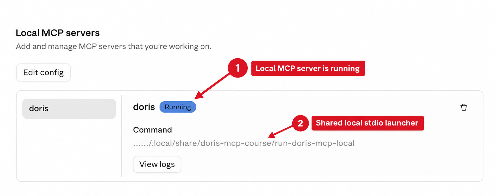
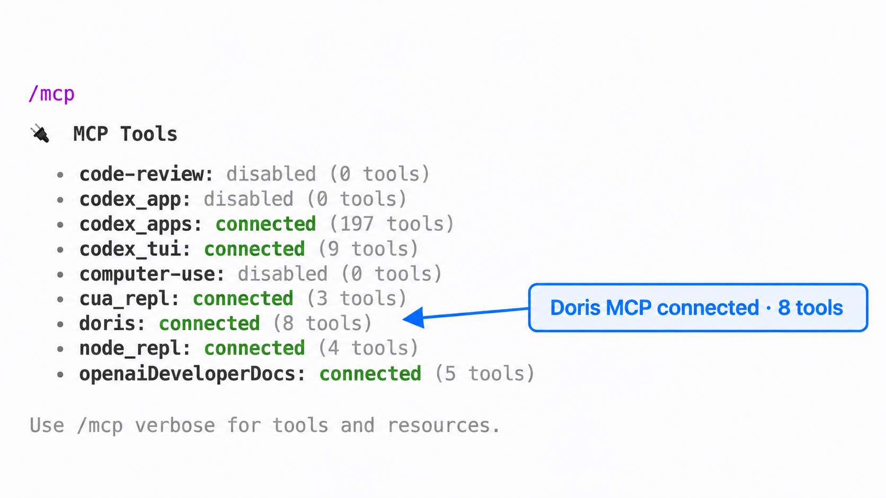
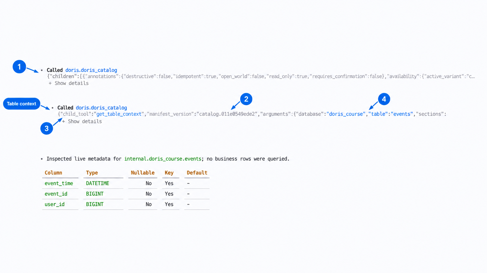
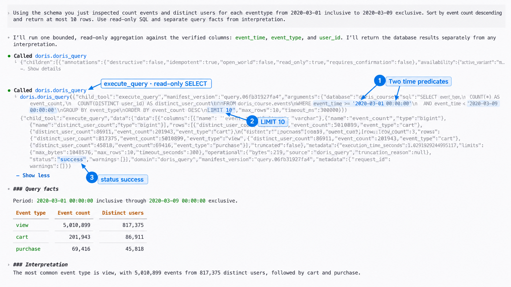
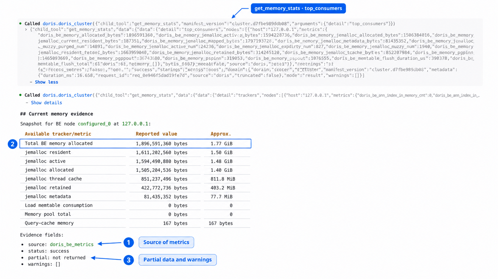

# Module 1: Connect AI Agents to Apache Doris with MCP

| Course information | Value |
| --- | --- |
| Course | AI Integrations with Apache Doris |
| Product baseline | Apache Doris 4.1.3 |
| Integration baseline | Apache Doris MCP Server 1.0.0 |
| MCP exposure | Hierarchical tools over local stdio |
| Estimated time | Approximately 60 minutes |

## Module goal

An analytics team already uses Apache Doris for event analysis. Its users now
want to ask an AI agent about the same data without copying schemas into a
prompt, giving the model an administrator account, or exposing the local
database over a new network service.

This module connects an AI agent to the official Apache Doris MCP Server. You
need **one** of these Hosts; connecting more of them is optional:

- Claude Desktop;
- Cursor;
- VS Code with GitHub Copilot;
- Codex CLI or the Codex desktop experience.

Each Host starts a local MCP Server process over standard input and output.
Every process connects to the same single-Frontend (FE), single-Backend (BE)
Doris teaching environment. The complete verification runs once, in any one
connected Host; the examples and screenshots use Codex. An additional Host only
needs a connection smoke test rather than repeating the same analysis.

This module is a guided Markdown workflow. There is no separate Jupyter
Notebook or Lab document. Commands and configuration blocks are intended for
the learner to run in their own environment; the course repository does not
store credentials.

## Learning objectives

After completing this module, you will be able to:

1. Identify the responsibilities of an MCP Host, MCP Client, MCP Server, and
   Apache Doris.
2. Summarize the eight built-in Doris MCP tool domains without treating the
   complete tool catalog as one lesson.
3. Prepare one protected local stdio launcher that any number of Hosts can
   share.
4. Connect an MCP Host such as Claude Desktop, Cursor, VS Code, or Codex to the
   local Doris target.
5. Use the connected Host to inspect real table context before executing a
   bounded read-only query.
6. Retrieve one bounded memory view from the `doris_cluster` domain while
   preserving source, partial-availability, and warning evidence.
7. Separate a successful MCP call, a Doris fact, and an agent interpretation.
8. Diagnose common path, port, permission, and capability failures without
   switching the Agent to a Doris administrator account.

## Follow one local analytics connection

The team begins with an existing local Doris dataset. It adds one boundary at a
time:

```text
confirm the existing Doris baseline
    -> create a least-privilege Doris identity
    -> prepare one protected stdio launcher
    -> register that launcher in at least one MCP Host
    -> verify the active connection in that Host
    -> ground the conversation in the real events schema
    -> execute one bounded read-only aggregation
    -> inspect one bounded BE memory view
    -> preserve facts, limitations, and approval boundaries
```

Each section turns a requirement into a decision:

| Section | Requirement scenario | Decision developed | Evidence produced |
| --- | --- | --- | --- |
| **1.1 Separate the four responsibilities** | The model, tool protocol, server process, and database are easy to collapse into one component. | Assign planning, transport, validation, and execution to the correct layer. | A local process and data-flow diagram. |
| **1.2 Read the capability map** | The Server exposes more capabilities than one lesson should demonstrate. | Introduce all eight domains, then select three children for the guided path. | A bounded domain map and selected-tool table. |
| **1.3 Confirm the course environment** | The repository contains both single-node and multi-node Doris environments. | Use the persistent Level 1–8 single-node baseline for this MCP module. | One FE, one BE, three loopback ports, and the verified `events` table. |
| **1.4 Prepare the stdio entry point** | Each Host configuration would otherwise need its own copy of the database password. | Put the route in one ignored local environment file and expose one launcher path. | A protected environment file and launcher contract. |
| **1.5 Connect a Host** | Each product stores local MCP configuration differently. | Register the shared launcher in at least one Host and verify only its product-specific connection state. | A connected state in each Host you use. |
| **1.6 Verify in one Host** | A connection alone does not prove useful or bounded tool behavior. | Ground in metadata, query read-only data, then inspect one memory view. | Three tool traces and a directly reproducible SQL result. |
| **1.7 Interpret the trace** | A polished answer can hide missing or partial evidence. | Read domain discovery, child execution, source, and warning fields separately. | An annotated trace and an evidence checklist. |
| **1.8 Keep the boundary safe** | Path, port, permission, and capability errors can look similar. | Troubleshoot from Doris outward without broadening privileges. | A symptom-to-check matrix. |

The workflow uses bounded evidence from a local teaching system. It does not
prove production availability, multi-node fault tolerance, or universal agent
accuracy.

---

## 1.1 Separate the Host, Client, Server, and Database

Model Context Protocol (MCP) gives an AI Host a standard way to discover and
call tools. It does not merge the Host, model, tool server, and database into
one trusted process.

```text
learner
   |
   v
AI Agent / MCP Host
keeps the conversation, invokes the model, and decides whether to request a tool
   |
   v
MCP Client inside the Host
starts and communicates with a local stdio child process
   |
   v
Apache Doris MCP Server
publishes schemas, validates bounded read-only requests, and returns evidence
   |
   v
local Apache Doris Docker environment
applies RBAC and executes metadata, SQL, and monitoring requests
```

> **Diagram placeholder — local MCP responsibility boundary**
> Replace this block with `assets/mcp-local-architecture.svg`. Show the four
> layers vertically. Use a solid arrow from the Host to the MCP Server labeled
> `stdio`, and separate arrows from the Server to `127.0.0.1:19030`, `:18030`,
> and `:18040`. Add a boundary around the learner's computer. Do not draw a
> public Internet endpoint between the Host and Server.

### The Host decides when to request a tool

The Host owns the conversation and model invocation. It may decide that a
question can be answered without a tool, ask the learner to approve a tool, or
request one of the schemas published by a connected Server. A Host-level tool
approval is therefore useful even when every Doris tool is read-only.

### The MCP Client owns the local process connection

For stdio, the Client starts a command as a child process and exchanges MCP
messages through that process's standard input and output. Opening four Hosts
at the same time normally creates four Server child processes. They reuse the
same implementation and launcher, but they are not one shared daemon.

### The Server constrains the request

The Doris MCP Server publishes typed inputs and outputs, performs read-only and
result-bound checks, selects configured Doris routes, and reports unavailable
evidence explicitly. It does not replace Doris authentication or RBAC.

### Doris remains the source of truth

Doris decides which catalogs, databases, tables, rows, and metadata the
configured identity can read. The final SQL result comes from Doris, not from
the model's training data. The agent's explanation remains an interpretation
of that result.

Keep these conclusions separate:

| Observation | What it establishes | What it does not establish |
| --- | --- | --- |
| The Host shows `doris` as connected | The Host initialized a local MCP Server process. | Every child capability is callable. |
| A child call succeeds | The current route, permission, and capability checks passed for that call. | Every number in the prose explanation is correct. |
| Doris returns rows | The SQL produced those rows under the configured identity. | The query represents the intended business population. |
| A monitoring child reports `partial` | Some bounded evidence is available and some is missing. | The missing value is zero or safe to infer. |

## 1.2 Read the Doris MCP Capability Map

Apache Doris MCP Server 1.0 organizes its built-in read-only catalog into eight
top-level domains. In hierarchical mode, the Host first calls a domain to
discover authorized children, exact schemas, runtime availability, and a
`manifest_version`. It then calls the same domain with one exact child request.

| Domain | Capability summary | Example question |
| --- | --- | --- |
| `doris_catalog` | Navigate catalogs, databases, tables, schemas, indexes, and bounded size evidence. | Which columns and indexes belong to this table? |
| `doris_query` | Execute bounded read-only SQL, explain plans, retrieve profiles, and diagnose query evidence. | What does this bounded aggregation return? |
| `doris_cluster` | Inspect nodes, active tasks, memory, cache, compaction, workload groups, and other runtime state. | Which memory trackers are observable now? |
| `doris_pipeline` | Inspect ingestion, materialized-view activity, data freshness, and bounded dependency evidence. | Is a Routine Load job progressing? |
| `doris_search` | Run and inspect bounded text, vector, and hybrid retrieval. | Is the requested search index and vector shape valid? |
| `doris_governance` | Analyze columns, storage, lineage, audit evidence, access patterns, and authorization mapping. | What quality or lineage evidence is available for this column? |
| `doris_lakehouse` | Inspect external catalogs, lakehouse table metadata, and Variant columns. | Which snapshots or pushdown evidence are visible for this table? |
| `doris_semantic` | Consume configured semantic or MetricFlow models and compile bounded metric requests. | Which reviewed metrics and dimensions are available? |

The reserved `doris_admin` surface is not registered. The built-in catalog is
read-only; this module does not enable a changing or administrative tool.

### Progressive disclosure keeps the first tool list bounded

Conceptually, discovery and execution have this shape:

```json
{}
```

The discovery response provides the child schema and a manifest version. A
subsequent request has this shape:

```json
{
  "child_tool": "<exact child name>",
  "arguments": {},
  "manifest_version": "<value returned by discovery>"
}
```

The learner does not write this JSON during the guided conversation. The Host
builds it from the published schema. The trace is expanded later so that the
learner can see the two stages.

### Select three children for one coherent path

This module introduces all eight domains but demonstrates only three children:

| Domain | Child | Reason for inclusion |
| --- | --- | --- |
| `doris_catalog` | `get_table_context` | Prevent the agent from inventing the `events` schema. |
| `doris_query` | `execute_query` | Produce one bounded, directly reproducible analytical result. |
| `doris_cluster` | `get_memory_stats` | Show one resource-observation path and preserve partial evidence. |

The course does not enumerate every child, execute a Query Profile, modify a
pipeline, or turn the agent into a complete monitoring console.

## 1.3 Confirm the Single-Node Course Environment

This module uses the persistent Level 1–8 teaching environment. It does not use
the isolated multi-node environment from Module 9.

| Environment property | Required value |
| --- | --- |
| Docker container | `doris-rta` |
| Image baseline | `apache/doris:all-in-one-4.1.3` |
| Topology | One FE and one BE |
| FE MySQL protocol | `127.0.0.1:19030` |
| FE HTTP | `127.0.0.1:18030` |
| BE web server | `127.0.0.1:18040` |
| Database | `doris_course` |
| Shared table | `events` |
| Expected rows | `10,158,080` |
| Expected time range | `2019-12-01 00:00:12` through `2020-03-11 04:53:08` |

The fixed environment serves three purposes:

- Catalog and Query examples can reuse the established `events` contract.
- The FE and BE HTTP ports required for the memory example have stable
  loopback mappings.
- The MCP lesson remains focused on agent integration rather than repeating
  FE election, replica placement, and failure recovery.

The single-node topology is why this module does not use
`get_cluster_overview` as a main demonstration. Reporting one FE and one BE
would add little beyond the environment preflight. `get_memory_stats` still
has a useful purpose: it shows how a resource child reports current evidence,
its source, and any partial-availability warning.

### Recover the expected prerequisite instead of creating a second sandbox

Use the following decision table before changing MCP configuration:

| Current state | Required action |
| --- | --- |
| The `doris-rta` container or `doris_course.events` does not exist | Complete [Lab 1: Start Doris and Build a Baseline Dataset](../../../01-real-time-analytics/level1/module01-introduction/lab01_start_doris_and_build_baseline.ipynb). Run its initialization, environment preparation, database creation, table creation, and baseline reload sections in order. |
| The `doris-rta` container exists but is stopped | Run **Restart the Doris sandbox** at the end of Lab 1. The named volumes preserve the baseline. |
| The Module 9 multi-node environment is running | Run **Stop the Module 9 cluster** in [Lab 9](../../../01-real-time-analytics/level3/module09-sharding-replication/lab09_observe_sharding_and_replication.ipynb), then run **Restart the Doris sandbox** in Lab 1. |
| The `events` count or time range differs | Rerun **Reload and validate the baseline dataset** in Lab 1. Do not repair the baseline inside this MCP module. |

Lab 3 creates `events_stream`, `events_s3`, and `events_routine`. None of those
tables is required here, so there is no need to run Lab 3 for this module.

### Verify Doris before debugging MCP

First confirm that the three loopback ports accept connections. Use a local
port-checking command available on your operating system, for example:

```bash
nc -z 127.0.0.1 19030
nc -z 127.0.0.1 18030
nc -z 127.0.0.1 18040
```

Then use the administrative identity only for this preflight and for creating
the lower-privilege account in the next section:

```bash
mysql -h 127.0.0.1 -P 19030 -u root -e '
SHOW FRONTENDS;
SHOW BACKENDS;
SELECT
  COUNT(*) AS row_count,
  MIN(event_time) AS min_event_time,
  MAX(event_time) AS max_event_time
FROM doris_course.events;
'
```

The expected evidence is:

- one joined, alive FE;
- one alive BE;
- `10,158,080` event rows;
- minimum event time `2019-12-01 00:00:12`; and
- maximum event time `2020-03-11 04:53:08`.

If this check fails, return to the prerequisite table. Changing a Host MCP file
cannot repair a stopped container, missing table, or incorrect baseline.

## 1.4 Prepare One Protected Local Stdio Entry Point

Host configurations should not each contain a copy of the same Doris
password. This module uses one ignored local environment file and one launcher.
Every Host stores only the absolute launcher path.

### Create a least-privilege Doris identity

Connect as the local course administrator and create a dedicated identity. Use
a generated password in place of the placeholder:

```sql
CREATE USER IF NOT EXISTS 'mcp_reader'@'%'
IDENTIFIED BY '<GENERATED_LOCAL_PASSWORD>';

GRANT SELECT_PRIV
ON internal.doris_course.*
TO 'mcp_reader'@'%';

SHOW GRANTS FOR 'mcp_reader'@'%';
```

The `%` host pattern allows the connection path used by the local Docker port
mapping. The Doris ports themselves remain bound to `127.0.0.1`, so they are
not published to the LAN. A production deployment should replace this teaching
choice with its reviewed identity, network, and secret-management policy.

Do not grant `ADMIN_PRIV`, `NODE_PRIV`, `LOAD_PRIV`, `ALTER_PRIV`,
`CREATE_PRIV`, or `DROP_PRIV`. The MCP Server's read-only checks are a second
boundary; they do not replace Doris RBAC.

Verify the new identity before introducing an Agent:

```bash
mysql -h 127.0.0.1 -P 19030 -u mcp_reader -p -e '
SELECT COUNT(*) AS row_count FROM doris_course.events;
'
```

### Install the pinned MCP Server in a local virtual environment

Run these commands from a local directory that is not committed with secrets:

```bash
python3.12 -m venv .venv
.venv/bin/pip install 'doris-mcp-server==1.0.0'
.venv/bin/doris-mcp-server --version
```

The Server command is `doris-mcp-server`. Do not substitute the separate
`doris-mcp-client` command in a Host configuration.

### Store the Doris route outside Host files

Create `.env.mcp.local` beside the virtual environment and add that file to the
applicable `.gitignore`:

```dotenv
DORIS_HOST=127.0.0.1
DORIS_PORT=19030
DORIS_USER=mcp_reader
DORIS_PASSWORD='<GENERATED_LOCAL_PASSWORD>'
DORIS_DATABASE=doris_course

DORIS_FE_HTTP_HOST=127.0.0.1
DORIS_FE_HTTP_PORT=18030
DORIS_BE_HOSTS=127.0.0.1
DORIS_BE_WEBSERVER_PORT=18040

MCP_TOOL_EXPOSURE_MODE=hierarchical
```

`DORIS_BE_HOSTS` contains the host allowlist. The web-server port remains in
`DORIS_BE_WEBSERVER_PORT`. All destinations are operator configuration; a
model request cannot supply an arbitrary FE or BE address.

Protect the file with permissions appropriate for your operating system. Do
not paste its contents into a screenshot, issue, chat message, or checked-in
Host configuration.

### Create the shared launcher

Use the provided executable file `run-doris-mcp-local` beside the environment
file. It resolves that directory from its own location:

```bash
#!/usr/bin/env bash
set -euo pipefail

MCP_HOME="$(CDPATH= cd -- "$(dirname -- "${BASH_SOURCE[0]}")" && pwd)"

set -a
. "$MCP_HOME/.env.mcp.local"
set +a

exec "$MCP_HOME/.venv/bin/doris-mcp-server" --transport stdio
```

Make the launcher executable:

```bash
chmod 700 /absolute/path/to/mcp-course/run-doris-mcp-local
```

The launcher has four important properties:

1. It resolves the environment and executable from the launcher's own absolute
   location, so the checked-in script contains no developer-specific path.
2. It keeps the password out of JSON and TOML Host files.
3. It replaces the shell with the Server process by using `exec`.
4. It leaves standard output exclusively for MCP protocol frames; diagnostic
   logging belongs on standard error or in a configured log file.

### Understand what several Hosts share

If you connect more than one Host, they share the launcher, package version,
and Doris target. They do not share one persistent stdio process. If several
Hosts are open, each Host may
start its own `doris-mcp-server` child process with the same route.

One running process also does not switch automatically between the single-node
and Module 9 environments. A future dual-target design would need two launcher
and server entries, such as `doris_single` and `doris_multinode`, each with its
own FE and BE routes. That design is outside this module.

## 1.5 Connect an MCP Host to the Doris Target

Connect at least one of the four Hosts below. One is enough to finish the
module; the others are optional. All of them use the same absolute launcher
path. Complete only the product-specific registration and connection check in
this section. Do not repeat the analytical workflow in every Host; Section 1.6
performs it once, in one Host.

Before capturing any screen:

- close editors that show `.env.mcp.local`;
- hide terminal history that contains secrets;
- crop user-specific home-directory segments when they add no teaching value;
- remove account names, API keys, session identifiers, and unrelated projects;
- keep the Server name, connection state, and relevant tool controls visible.

### Connect Claude Desktop

Open Claude Desktop's local MCP configuration entry and add the following
server to `claude_desktop_config.json`:

```json
{
  "mcpServers": {
    "doris": {
      "command": "/absolute/path/to/mcp-course/run-doris-mcp-local",
      "args": []
    }
  }
}
```

If the file already contains other servers, merge the `doris` object into its
existing `mcpServers` object instead of replacing the file.

Then:

1. Save the configuration.
2. Fully quit Claude Desktop so that its local processes stop.
3. Reopen Claude Desktop.
4. Open **Settings > Developer**.
5. Confirm that the `doris` local MCP Server shows **Running**. This page proves
   that Claude Desktop initialized the local process; no chat message is needed.



*The `doris` row and its **Running** state are the connection evidence. The
protected environment file is not displayed.*

This screenshot establishes product connection state. The JSON block remains
the source that learners copy.

### Connect Cursor

For a project-scoped connection, create `.cursor/mcp.json` in the project that
will host the demonstration:

```json
{
  "mcpServers": {
    "doris": {
      "command": "/absolute/path/to/mcp-course/run-doris-mcp-local",
      "args": []
    }
  }
}
```

Cursor can also use a user-scoped `~/.cursor/mcp.json`. This module uses the
project-scoped file so that the intended scope is visible, while the password
remains outside the project.

Then:

1. Save `.cursor/mcp.json`.
2. Reload or restart Cursor.
3. Open Cursor Settings and navigate to the MCP or Tools & MCP page provided by
   the installed version.
4. Open **Configure doris** and confirm that the project source is enabled and
   **Local** shows **Connected**.
5. Expand **Tools** and confirm that the Doris domain tools are listed. Do not
   send a chat message or change unrelated global auto-run settings.


*The enabled project source, **Local Connected** state, and Doris tool list are
visible together. This is a connection check only; no LLM request was sent.*

If the Server fails, open the Output panel and select MCP Logs before changing
the database account. A GUI-specific `PATH` failure is more likely to require
an absolute executable or launcher path than broader Doris privileges.

### Connect VS Code with GitHub Copilot

Create `.vscode/mcp.json` in the workspace:

```json
{
  "servers": {
    "doris": {
      "type": "stdio",
      "command": "/absolute/path/to/mcp-course/run-doris-mcp-local",
      "args": []
    }
  }
}
```

The workspace file may contain the launcher path, but it must not contain the
Doris password.

Then:

1. Save `.vscode/mcp.json`.
2. Select the **Start** CodeLens shown above the `doris` definition, or run
   **MCP: List Servers** from the Command Palette and start `doris`.
3. Open **View > Output** and select **MCP: doris** from the output-channel
   selector.
4. Confirm that the log contains **Connection state: Running** and
   **Discovered 8 tools**.
5. Open GitHub Copilot Chat only to confirm that its Agent selector is
   available. Do not enter or send a prompt during this connection check.


*The MCP output supplies the runtime evidence, while the empty chat panel shows
that the connection was verified without starting an LLM conversation.*

### Connect Codex CLI and the desktop experience

Codex stores local MCP configuration in `config.toml`. By default, edit
`~/.codex/config.toml` and add:

```toml
[mcp_servers.doris]
command = "/absolute/path/to/mcp-course/run-doris-mcp-local"
args = []
required = true
startup_timeout_sec = 20
tool_timeout_sec = 60
```

`required = true` makes a failed Server initialization visible instead of
silently continuing without this required course dependency.

Check the registered configuration. `codex mcp get doris` prints the transport,
launcher, enabled state, and timeouts for this one Server:

```bash
codex mcp get doris
```

Start the Codex terminal interface and use:

```text
/mcp
```

The active Server list should show `doris: connected (8 tools)`.
Official OpenAI documentation also
allows the desktop experience to register a Server through **Settings > MCP
servers > Add server**. Choose **STDIO**, enter the same launcher command, save,
and select **Restart**. Codex CLI, the desktop experience, and the IDE extension
share MCP configuration for the same Codex host.



*The `/mcp` inventory is runtime evidence: Codex initialized `doris` and
received all eight domain tools. Running `/mcp` inspects the connection and
does not send an analytical prompt.*

### Connection smoke-test boundary

At the end of this section, every Host you connected should initialize its own
local Server process. Choose one of them for the complete tool workflow in
Section 1.6.

| Host | Connected-state evidence |
| --- | --- |
| Claude Desktop | `doris` shows **Running** in Developer settings |
| Cursor | Project source enabled; **Local Connected**; tools listed |
| VS Code | **Running**; eight tools discovered; chat left empty |
| Codex | `doris: connected (8 tools)` in `/mcp` |

## 1.6 Verify the Complete Path in One Host

Use one continuous conversation in one connected Host for the three requests in
this section. The examples and screenshots come from Codex. Other Hosts show the
tool calls, their arguments, and their results in their own chat view; the
checks below do not depend on the product.
The prompts describe the analytical intent. They do not tell the learner to
name an MCP domain or dictate a child tool. Tool selection is the Host's job;
the trace provides evidence of what it selected.

### Step 1: ground the conversation in the real table

Enter this prompt:

> Inspect the schema, key columns, and index context for
> `doris_course.events`. Do not query business rows, and do not invent fields
> that are absent from the returned table context.

In hierarchical mode, the expected internal path is:

```text
doris_catalog {}
    -> return authorized child schemas and manifest_version
    -> doris_catalog/get_table_context
       database = doris_course
       table = events
```

The response should be grounded in the actual table metadata. It should not
silently add common ecommerce fields such as `session_id`, `device_type`, or
`category_id` when those fields are absent.

Check the answer against the established table contract:

| Field | Course baseline type |
| --- | --- |
| `event_time` | `DATETIME` |
| `event_id` | `BIGINT` |
| `user_id` | `BIGINT` |
| `event_type` | `VARCHAR(32)` |
| `region` | `VARCHAR(16)` |
| `product_id` | `BIGINT` |
| `revenue` | `DECIMAL(12,2)` |

The live response returned all seven columns above. It identified
`event_time`, `event_id`, and `user_id` as key columns, reported zero secondary
indexes, and did not return a Doris key model, distribution definition, or
partition definition. An independent `DESCRIBE events` using `mcp_reader`
matched every returned column, type, nullability flag, key flag, and default.



*Callout 1 is the domain discovery. Callouts 2–4 identify the manifest version,
child tool, and sanitized arguments used for the table-context execution.*

The screenshot proves which tool path supplied the context. The answer text
proves only how the agent summarized that context.

### Step 2: execute a bounded read-only aggregation

Continue in the same conversation:

> Using the schema you just inspected, count events and distinct users for
> each `event_type` from 2020-03-01 inclusive to 2020-03-09 exclusive. Sort by
> event count descending and return at most 10 rows. Use read-only SQL, and
> separate query facts from interpretation.

The expected path is:

```text
doris_query {}
    -> return authorized child schemas and manifest_version
    -> doris_query/execute_query
       one bounded SELECT statement
```

The generated SQL should have this semantic shape:

```sql
SELECT
    event_type,
    COUNT(*) AS event_count,
    COUNT(DISTINCT user_id) AS distinct_users
FROM doris_course.events
WHERE event_time >= '2020-03-01 00:00:00'
  AND event_time <  '2020-03-09 00:00:00'
GROUP BY event_type
ORDER BY event_count DESC
LIMIT 10;
```

The exact result values come from the current verified baseline. Reproduce the
same SQL outside the Agent before accepting its numbers:

```bash
mysql -h 127.0.0.1 -P 19030 -u mcp_reader -p \
  --database doris_course \
  --execute "
SELECT
    event_type,
    COUNT(*) AS event_count,
    COUNT(DISTINCT user_id) AS distinct_users
FROM events
WHERE event_time >= '2020-03-01 00:00:00'
  AND event_time <  '2020-03-09 00:00:00'
GROUP BY event_type
ORDER BY event_count DESC
LIMIT 10;
"
```

Compare the complete result, not just the first row. The expected controls are:

- one `SELECT` statement;
- the requested inclusive lower and exclusive upper time boundaries;
- grouping by `event_type`;
- descending event-count order;
- `LIMIT 10`; and
- no DDL, DML, administrative statement, or stacked second statement.

The live tool call returned three rows:

| `event_type` | `event_count` | `distinct_users` |
| --- | ---: | ---: |
| `view` | 5,010,899 | 817,375 |
| `cart` | 201,943 | 86,911 |
| `purchase` | 69,416 | 45,818 |

The independent MySQL client returned the same three rows and values in the
same order. The Server result also reported `status=success`,
`operation=SELECT`, `truncated=false`, and no warnings.



*The numbered annotations identify the two time predicates, `LIMIT 10`, and
the successful tool status. The result table is the actual local Doris result.*

Treat the MySQL client result as the numerical cross-check. The Agent may make
a useful interpretation, but that interpretation must not replace the returned
rows.

### Step 3: inspect one memory evidence path

Continue without starting a new conversation:

> Inspect the current Doris memory-use evidence. Summarize the most important
> available memory trackers, preserve source, partial, and warning fields, and
> do not infer values for unavailable metrics.

The expected path is:

```text
doris_cluster {}
    -> return authorized child schemas and manifest_version
    -> doris_cluster/get_memory_stats
       bounded tracker and source evidence
```

This is an observability example, not a cluster-availability test. The course
environment has one BE. The useful questions are:

- Which tracker or category did the Server return?
- Which FE, BE, SQL, or HTTP source produced the evidence?
- Did the response declare itself complete or partial?
- Did it include a warning or unavailable section?
- Did the agent preserve those limitations in its answer?

The live snapshot returned these leading values for BE node `configured_0`:

| Tracker or metric | Reported value | Approximate value |
| --- | ---: | ---: |
| Total BE memory allocated | 1,896,591,360 bytes | 1.77 GiB |
| jemalloc resident | 1,611,202,560 bytes | 1.50 GiB |
| jemalloc active | 1,594,490,880 bytes | 1.48 GiB |
| jemalloc allocated | 1,505,204,536 bytes | 1.40 GiB |

The accompanying evidence fields were `source=doris_be_metrics`,
`status=success`, `partial` not returned, `warnings=[]`, `truncated=false`, and
`invented_values=false`. These are live counters and will change between
runs; the provenance and limitation fields are the stable teaching target.



*The annotations identify the source, the leading returned metric, and the
absence of a partial flag or warnings. No warning was added for presentation.*

Do not extend this step into CPU, disk, compaction, Query Profile, or a complete
monitoring dashboard. One well-bounded resource example is enough to show the
domain switch.

### Evaluate the final conversation as one evidence chain

The three requests should form one traceable chain:

| Stage | Doris-backed fact | Agent responsibility | Independent check |
| --- | --- | --- | --- |
| Table context | Returned columns, types, and index sections | Summarize without inventing fields | Compare with `DESCRIBE` or the established Lab 1 contract |
| Aggregation | Returned rows from the bounded `SELECT` | Separate result facts from interpretation | Run the same SQL with the MySQL client |
| Memory | Returned tracker, source, and availability fields | Preserve partial and warning evidence | Inspect the original structured tool result |

An answer passes only when the trace, Doris result, and prose agree. A fluent
answer without the required call, a successful call with altered numbers, or a
monitoring summary that removes warnings does not pass.

## 1.7 Read the Tool Trace as Evidence

The first domain call can contain only `{}` because its purpose is discovery.
The returned manifest tells the Host which children are currently authorized
and callable, their exact schemas, and the manifest version to bind to the next
request.

The child execution then carries three important fields:

| Field | Role | Failure to avoid |
| --- | --- | --- |
| `child_tool` | Selects one exact capability inside the domain. | Guessing an old pre-1.0 tool alias. |
| `arguments` | Supplies values validated by that child's schema. | Sending arbitrary SQL, hostnames, or unbounded values where the schema does not allow them. |
| `manifest_version` | Binds execution to the discovered capability generation. | Reusing a stale manifest after capability or authorization state changes. |


1. Domain discovery obtains the authorized child schemas.
2. `manifest_version` binds the next call to that capability generation.
3. `child_tool` selects `get_table_context`.
4. `arguments` supplies `database=doris_course` and `table=events`.

### Preserve unavailability instead of bypassing it

A child can belong to the public catalog and still report `callable=false` for
the current runtime. Version, configuration, route, provider, permission, or
live evidence can make a child unavailable.

The correct response is to preserve the structured reason and fix the matching
operator-controlled condition. Do not:

- change the MCP caller to `root`;
- let the model provide a different FE or BE hostname;
- invent a missing metric from an unrelated counter;
- silently switch from hierarchical to flat mode during a conversation; or
- describe a partial result as a complete cluster diagnosis.

If the Server reports a stale child manifest, rediscover the domain with `{}`
and use the new returned version. Flat exposure is a Host-compatibility fallback
configured before process startup, not a per-prompt workaround.

### Separate facts from interpretation

Use this reading order whenever an agent answers a Doris question:

```text
identify the selected tool
    -> inspect sanitized arguments
    -> inspect structured result and warnings
    -> reproduce the decisive SQL when applicable
    -> evaluate the prose interpretation last
```

This order prevents a confident explanation from becoming stronger evidence
than the database result that it summarizes.

## 1.8 Keep the Connection Safe and Diagnosable

The integration has four separate boundaries. Keep all four rather than relying
on the MCP Server's read-only catalog alone.

| Boundary | Course control | Risk it limits |
| --- | --- | --- |
| Doris identity | `mcp_reader` receives only `SELECT_PRIV` on `internal.doris_course.*`. | A Server or Host defect cannot use administrator privileges through this identity. |
| MCP Server | Built-in read-only tools, bounded schemas, result ceilings, and hierarchical discovery. | The model cannot turn a normal query child into arbitrary administration. |
| Host | Local stdio process and tool approval. | A tool request remains visible at the user interaction boundary. |
| Network and secrets | Doris ports bind only to loopback; the password stays in an ignored protected file. | The lesson does not create a new remote service or check credentials into the project. |

### Troubleshoot from Doris outward

Use the following order:

```text
Docker and ports
    -> direct Doris identity and data
    -> launcher process and stderr
    -> Host connection state
    -> domain and child availability
    -> prompt and answer interpretation
```

Changing several layers at once makes evidence harder to interpret.

| Symptom | First check | Correct direction |
| --- | --- | --- |
| `19030` refuses the connection | Is the `doris-rta` container running and healthy? | Recover the Lab 1 sandbox before changing MCP files. |
| The baseline table is absent or has unexpected rows | Does the Lab 1 validation pass? | Rerun the Lab 1 baseline section; do not create a replacement table here. |
| The Host reports that the Server failed to start | Does the absolute launcher path exist and have execute permission? | Run the launcher under the same local user and inspect stderr. |
| CLI works but a GUI Host fails | Does the GUI inherit the same `PATH` and environment? | Keep absolute launcher, environment-file, and virtual-environment paths. |
| The Server starts but Doris authentication fails | Can `mcp_reader` run the direct count query? | Correct the protected password or account grant; do not switch the Agent to `root`. |
| Tools are visible but a query is rejected | Is the SQL one bounded read-only statement? | Reduce scope, add the required bound, or correct the schema-derived SQL. |
| `get_memory_stats` is unavailable or partial | Are `18030` and `18040` reachable, and are FE/BE HTTP settings correct? | Repair the configured evidence route and preserve the unavailable reason. |
| A child reports a stale manifest | Did capability or authorization state change? | Rediscover the domain with `{}` and use the new manifest version. |
| A Host cannot complete progressive discovery | Does that Host support the hierarchical flow? | Record the incompatibility, then configure `MCP_TOOL_EXPOSURE_MODE=flat` before restart as a bounded fallback. |
| The SQL result is correct but the explanation is not | Do the prose numbers and claims match the structured result? | Correct the interpretation; do not rerun unrelated tools to justify it. |

Failure screenshots are intentionally omitted. Error layouts change frequently,
while the symptom, first check, and corrective boundary remain stable. Use text
and copied sanitized error codes in the final course instead of maintaining a
gallery of transient error dialogs.

### Completion checklist

- [ ] The active Doris environment is the Level 1–8 single-FE, single-BE
  `doris-rta` container.
- [ ] Ports 19030, 18030, and 18040 are reachable only through the intended local
  mappings.
- [ ] `doris_course.events` contains the verified Lab 1 baseline.
- [ ] `mcp_reader` can read the course database and does not have Doris
  administrator, node, load, alter, create, or drop privileges.
- [ ] The protected environment file is ignored by version control.
- [ ] At least one Host starts the shared launcher and shows a connected
  state; any additional Host uses the same launcher path and Doris ports.
- [ ] The agent reads table context before generating the analytical SQL.
- [ ] The generated SQL uses the required time range, grouping, order, and
  `LIMIT 10`.
- [ ] The Agent's query rows match the same SQL executed through the MySQL
  client.
- [ ] The memory answer preserves source, `partial`, `warning`, and unavailable
  evidence exactly as returned.

### Review questions

1. Why does Doris still need a least-privilege identity when the built-in MCP
   catalog is read-only?
2. What does hierarchical discovery reduce, and why must execution include the
   returned manifest version?
3. Why can four open Hosts create four MCP Server processes even though they
   use one launcher configuration?
4. Why is `get_memory_stats` useful in the single-BE sandbox while a cluster
   availability demonstration is deferred?
5. Which evidence should you compare before accepting numerical claims in an
   agent's final answer?
6. Why is a `partial` monitoring result evidence to preserve rather than an
   inconvenience to hide?

---

## Guided workflow summary

| Stage | What you do | What the result establishes |
| --- | --- | --- |
| **Environment** | Reuse the verified Lab 1 container and event baseline. | MCP failures can be separated from missing Doris prerequisites. |
| **Identity** | Create `mcp_reader` with database-level read permission only. | Doris RBAC remains the final data boundary. |
| **Launcher** | Read one protected local environment file and start stdio with absolute paths. | Host files avoid duplicated secrets and GUI `PATH` assumptions. |
| **Host connection** | Register the launcher in at least one Host: Claude Desktop, Cursor, VS Code, or Codex. | The Host can initialize the local integration; other Hosts reuse the same shape. |
| **Catalog grounding** | Ask the agent to inspect `doris_course.events`. | The answer begins from live schema evidence. |
| **Bounded query** | Ask for a fixed-window aggregation and reproduce it directly. | Agent output can be checked against Doris rows. |
| **Memory evidence** | Ask for current memory trackers and keep source and warnings. | One `doris_cluster` path demonstrates bounded operational evidence. |
| **Trace review** | Inspect discovery, manifest, child arguments, and result fields. | Product UI, protocol evidence, and prose interpretation remain distinct. |

## Module summary

MCP adds a governed tool boundary between an AI Host and Apache Doris. The Host
owns the conversation and tool decision. Its MCP Client owns the local stdio
process. The Doris MCP Server publishes schemas, validates bounded read-only
requests, and preserves availability evidence. Doris still owns authentication,
authorization, metadata, SQL execution, and returned facts.

The eight domains organize the complete product surface, but a course does not
need to demonstrate all of them. This module uses table context to prevent
schema invention, a bounded query to produce reproducible analytical facts,
and one memory child to show operational evidence without pretending that a
single-BE sandbox proves cluster availability.

Claude Desktop, Cursor, VS Code, and Codex can reuse the same launcher and
Doris route. Under stdio they normally start separate child processes. A second
Doris environment would require a separately named route and Server entry; a
single process does not switch databases or port sets because a prompt asks it
to do so.

Finally, tool success and answer correctness are different checks. Read the
tool trace, preserve warnings, reproduce decisive SQL, and evaluate the model's
interpretation last.

## Official references

- Apache Doris MCP Server: [README](https://github.com/apache/doris-mcp-server/blob/master/README.md), [Quickstart](https://github.com/apache/doris-mcp-server/blob/master/docs/getting-started/quickstart.md), and [Deployment](https://github.com/apache/doris-mcp-server/blob/master/docs/operations/deployment.md)
- Apache Doris MCP Server: [Host integrations](https://github.com/apache/doris-mcp-server/blob/master/docs/integrations/hosts.md), [Tool domains](https://github.com/apache/doris-mcp-server/blob/master/docs/capabilities/tool-domains.md), and [Configuration reference](https://github.com/apache/doris-mcp-server/blob/master/docs/reference/configuration.md)
- Apache Doris: [CREATE USER](https://doris.apache.org/docs/4.x/sql-manual/sql-statements/account-management/CREATE-USER/), [GRANT TO](https://doris.apache.org/docs/4.x/sql-manual/sql-statements/account-management/GRANT-TO/), and [SHOW GRANTS](https://doris.apache.org/docs/4.x/sql-manual/sql-statements/account-management/SHOW-GRANTS/)
- OpenAI Docs: [Model Context Protocol](https://learn.chatgpt.com/docs/extend/mcp)
- Anthropic Support: [Getting started with local MCP servers on Claude Desktop](https://support.claude.com/en/articles/10949351-getting-started-with-local-mcp-servers-on-claude-desktop)
- Cursor: [Model Context Protocol](https://prod.cursor.com/help/customization/mcp)
- Visual Studio Code: [MCP configuration reference](https://code.visualstudio.com/docs/agents/reference/mcp-configuration)
