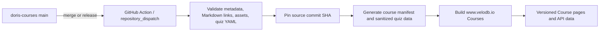
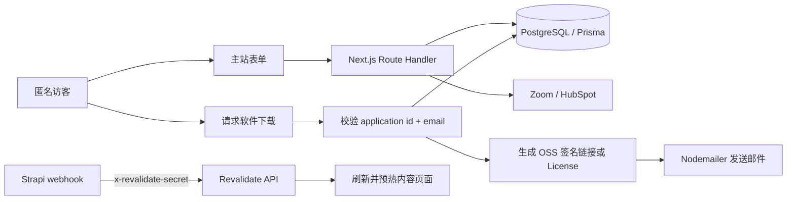
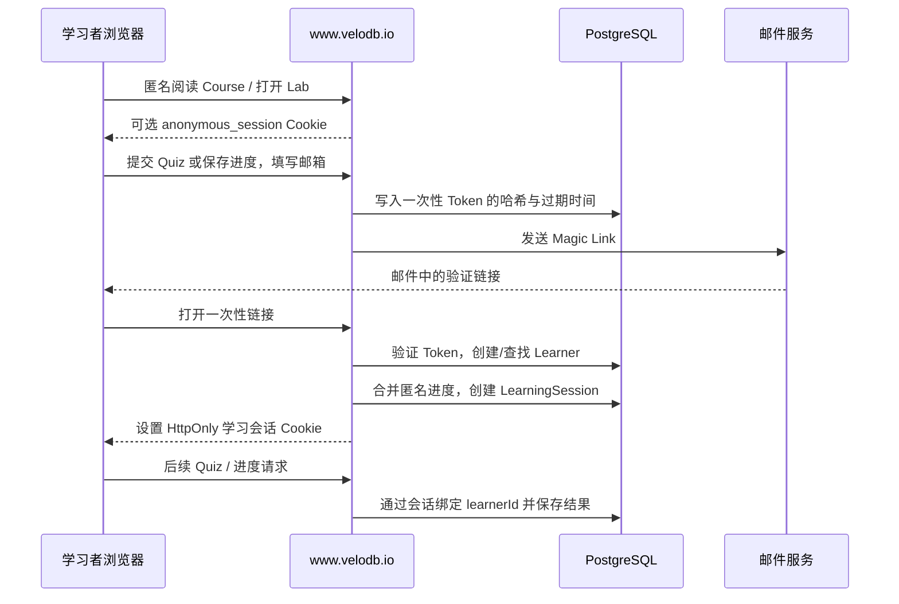
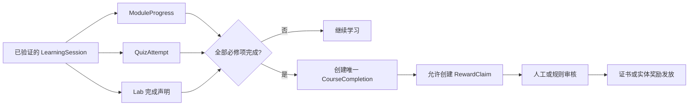
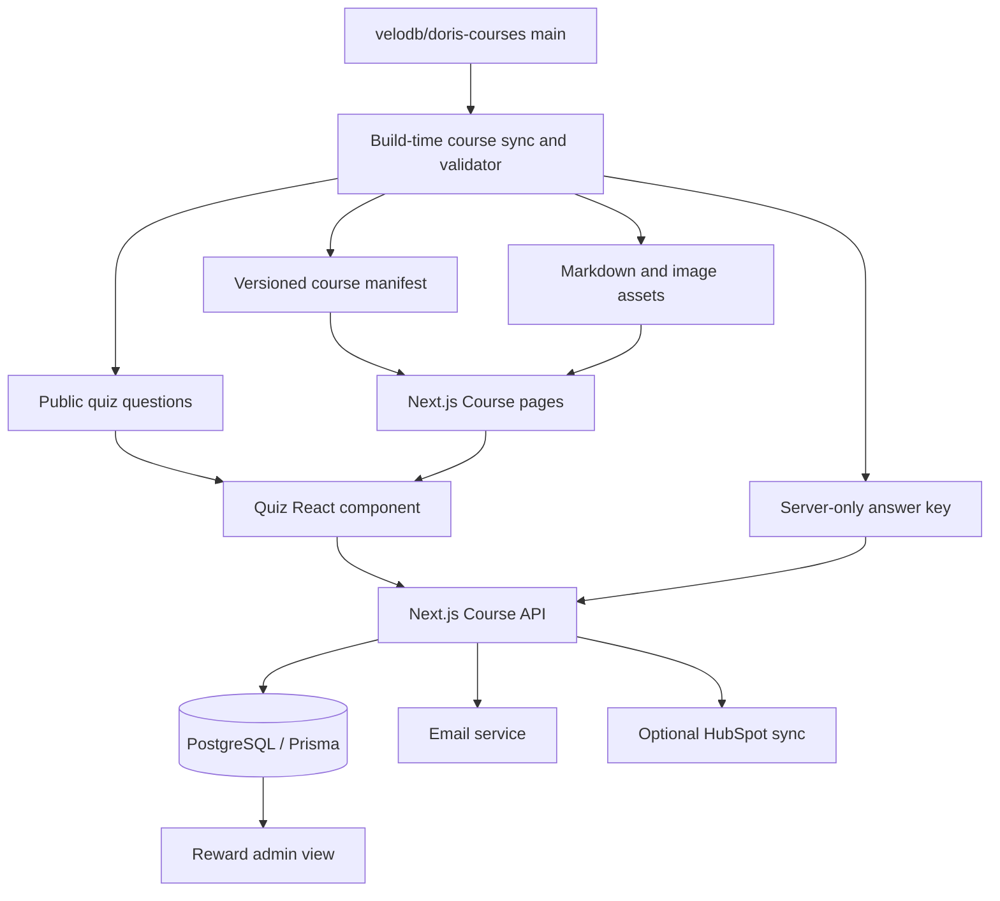

# 将 Apache Doris 课程接入 VeloDB 官网的产品与技术方案

> 调研日期：2026-10-10  
> 课程仓库：[velodb/doris-courses](https://github.com/velodb/doris-courses)  
> 网站仓库：`selectdb/velodb-website`（私有仓库，本次已通过现有 GitHub 权限读取，无需追加登录授权）  
> 报告范围：信息架构、课程清单、页面形态、内容同步、交互式 Quiz、完成记录、奖励申请、数据模型、实施资源与上线顺序。本文不包含网站代码修改。

## 1. 官网入口与信息架构建议

建议把课程的**目录、正文、Quiz 和学习进度全部放在 `www.velodb.io`**，复用主站现有 **Resources > Support > Training & Certification** 入口，将其从 `/coming-soon` 改为 `/courses`。页面标题可以使用 **Apache Doris Training & Courses**，导航文字可以继续保留 **Training & Certification**。

截图进一步说明，`docs.velodb.io` 不是中立的学习站。选择 VeloDB Cloud 或 VeloDB Enterprise 后，顶部导航、`Resources` 内容和左侧文档树都会随产品切换。Real-time、Data Warehousing 和 Observability 课程主要运行开源 Apache Doris Docker 环境，并不要求 VeloDB Cloud，也不应被放进某个商业产品的 `Resources`。

`www.velodb.io` 与 `docs.velodb.io` 也不是同一个前端工程：前者由 `selectdb/velodb-website` 的 Next.js 应用承载，后者是独立的 Docusaurus 文档站。既然课程还需要交互式 Quiz、完成记录和奖励数据库，把阅读与交互都放进主站可以避免跨站登录、Cookie、CORS 和两套发布流水线。

### 1.1 主入口：Resources > Support > Training & Certification

主站现有 `Training & Certification` 已经表达了课程与认证用途，但目前只指向 `/coming-soon`。推荐保留这一菜单行并更新链接：

```ts
{ title: 'Training & Certification', link: '/courses' }
```

该入口位于 Support 列，因此无需在 Learn 列增加第五项，也不会继续拉长已经较高的左列。课程既能服务 Apache Doris 社区学习者，也能在适当章节说明相同能力如何映射到 VeloDB Cloud 或 Enterprise，而不把整个学习路径绑定到任何产品。

### 1.2 课程目录可以借用 Blog 的视觉语言

Blog 列表已经形成成熟的深色营销视觉：Hero、分类切换、图片卡片、标题、摘要和作者/日期。`/courses` 可以复用同一套品牌色、卡片圆角、间距、响应式网格和图片比例，但卡片字段应改为课程信息：

- 学习路径标题和业务目标；
- Level、Module 数量和难度；
- 预计时长和先决条件；
- Course、Lab、Quiz 的可用状态；
- `Start course` 或 `Continue`；
- 已验证用户的完成进度。

课程目录不应伪装成 Blog：不使用作者、发布日期和 Blog 分类作为核心字段，也不让四条学习路径混入普通文章流。

### 1.3 Course 正文使用专门的学习页面

具体 Blog 文章证明主站已经能显示长篇 Markdown、标题层级、代码、图片和表格，因此可以复用其 Markdown 编译组件和正文排版基础。但 Course 还需要 Blog 没有的学习结构：

- 学习路径、Level 和 Module 目录；
- 当前 Module 的目标、先决条件和预计时长；
- 右侧页内目录；
- 上一 Module / 下一 Module；
- 固定版本的 `Open Lab on GitHub`；
- 内嵌或独立路由的交互式 Quiz；
- 完成状态、继续学习和奖励资格。

因此实现方式应是“复用 Blog 的视觉组件和 Markdown 能力，新增 Course shell”，而不是把 Course 存成一篇 Blog。Quiz 可以直接使用 React 组件并调用同域 Next.js Route Handler；这比在 Docusaurus 中嵌入登录、判分和奖励状态简单。

### 1.4 Docs 和其他页面的角色

Docs 不再作为课程入口或正文宿主。课程中的概念和配置仍可链接到对应的 Apache Doris、VeloDB Cloud 或 VeloDB Enterprise 官方文档。若某个产品文档确实需要培训链接，可以添加返回 `www.velodb.io/courses/...` 的上下文 CTA，但不能把开源课程挂在 Cloud 或 Enterprise 的产品目录下。

相关 Solution、Blog 和 Demo 页面也可以链接具体学习路径：

- Real-Time Analytics Solution → Real-time Analytics Course；
- Data Warehousing Solution → Data Warehousing Course；
- Observability Solution → Observability Course；
- Context Engineering 或 AI 页面 → Doris MCP Course。

推荐入口关系如下：

```text
www.velodb.io 顶部 Resources
└── Support
    └── Training & Certification
        └── /courses                         ← 课程目录
            ├── /courses/real-time-analytics
            ├── /courses/data-warehousing
            ├── /courses/observability
            └── /courses/ai-integrations

Solution、Blog、Demo 或产品 Docs
└── 对应学习路径或 Module                     ← 可选上下文链接
```

第一版可以在主站上线课程目录、Markdown Course 页面和固定版本的 GitHub Lab 链接；Quiz、进度和奖励随后接入。生产站只发布 `velodb/doris-courses` 的 `main` 分支中满足发布契约的内容，不能直接展示开发者本地文件或未合入 PR。

## 2. 现有课程结构与内容

### 2.1 盘点范围与总体目录

本节同时检查了 `upstream/main` 和当前开放 PR，而不是只读取本地 checkout。仓库正在形成四条面向学习者的路径：

| 学习路径 | 规模 | 内容主线 | 学习资产现状 | 当前来源 |
| --- | --- | --- | --- | --- |
| Real-time Analytics with Apache Doris | 3 个 Level、10 个 Module | 从事件数据基线、导入和建模，逐步进入查询加速、分布式执行与生命周期管理 | 10 组 Course/Lab/Quiz 已开发；`main` 中 Level 3 仍不完整 | `main` + [PR #5](https://github.com/velodb/doris-courses/pull/5) |
| Data Warehousing with Apache Doris | 3 个 Level、14 个 Module | 从订单数据导入和质量处理，进入数仓建模、服务交付、权限和资源治理 | 14 组 Course/Lab/Quiz，另有流式、湖表、BI 和备份环境 | [PR #4](https://github.com/velodb/doris-courses/pull/4)、[PR #8](https://github.com/velodb/doris-courses/pull/8)、[PR #9](https://github.com/velodb/doris-courses/pull/9) |
| Observability with Apache Doris | 2 个 Level、8 个 Module | 用 DOG、OpenTelemetry 和 Grafana 完成可观测数据采集、建模、分析与告警 | 8 个 Lab、8 个 Quiz Notebook/YAML；目前没有 Course Markdown | [PR #10](https://github.com/velodb/doris-courses/pull/10) |
| AI Integrations | 1 个 Module | 让多个 AI Agent 通过 Doris MCP Server 安全读取元数据和执行有边界查询 | 1 篇 Guided Course；没有独立 Lab Notebook 和 Quiz YAML | [PR #11](https://github.com/velodb/doris-courses/pull/11) |

这里的“存在”不等于“已发布”：开放 PR 中的内容可以用于产品规划和页面设计，但网站同步器只能发布已经合入 `main`、通过校验并标记为 `published` 的版本。关闭的 PR #6、#7 是 Real-time 课程的替代开发历史，不应在目录里重复计算为新课程。

维护说明、研究笔记和内部大纲也不属于学员目录。例如 `04-ai-integrations` 下的 `doris-ai-course-research.md`、`clickhouse-ai-course-research.md` 和模块开发 `readme.md` 只服务课程开发。

### 2.2 Real-time Analytics：事件分析的完整进阶路径

该路径面向具备基础数据库和 SQL 经验的学习者，使用统一的 `doris_course` Database 和连续事件数据资产。Course 解释需求和选择依据，Lab 用 Doris 4.1.3、SQL、`EXPLAIN` 和 Query Profile 提供证据，Quiz 检查场景判断。

| Level | Module | 业务问题与主要内容 |
| --- | --- | --- |
| Level 1 | 1. Introduction to Apache Doris | 识别实时分析场景，理解 Frontend（FE）/Backend（BE）角色，启动环境并建立事件基线 |
| Level 1 | 2. Deep Dive into Apache Doris Architecture | 理解 Table Model、Partition、Bucket、Tablet 和列式扫描，观察如何减少扫描范围 |
| Level 1 | 3. Loading Data into Apache Doris | 在有界导入和持续摄取之间选择，实践 S3、Stream Load，并理解 Kafka/Routine Load 和重试安全 |
| Level 2 | 4. Modeling Data in Apache Doris | 从业务 grain 选择 Table Model、类型、NULL/default、Partition、Bucket 和汇总表 |
| Level 2 | 5. Analyzing Data in Apache Doris | 根据输入输出关系选择 Scalar、Aggregate、Table Function 和 Window Function |
| Level 2 | 6. Joining Data in Apache Doris | 区分逻辑 Join、物理实现和多 BE 数据分发，理解 build/probe side、Broadcast、Shuffle 和 Colocate |
| Level 2 | 7. Updating and Deleting Data in Apache Doris | 用 Unique Key 表达当前状态，处理 upsert、partial update、delete 和范围替换 |
| Level 3 | 8. Accelerating Queries in Apache Doris | 根据复用、预计算和过滤需求选择普通 View、同步/异步物化视图和倒排索引，并解释改写证据 |
| Level 3 | 9. Sharding, Replication, and Distributed Execution | 理解 FE 入口、BE 扩容和副本恢复、多 BE 扫描，以及 Bucket Shuffle/Colocate Join |
| Level 3 | 10. Controlling Storage Cost and Data Lifecycle | 根据数据形状选择 LZ4F/ZSTD，管理 Dynamic Partition、晚到数据、生命周期和回收站恢复 |

学习顺序是：

```text
建立基线与理解架构 → 选择导入方式 → 设计模型 → 编写分析与 Join
→ 维护当前状态 → 加速查询 → 理解分布与可用性 → 管理存储与生命周期
```

完整开发版本约 13 小时 10 分钟，Lab 10 另含跨整点观察 Dynamic Partition 的可选等待。该时长来自当前课程自身的估算，不应用于推算其他学习路径。

### 2.3 Data Warehousing：从订单导入到生产治理

该路径面向数据工程师和分析工程师，以 WWI 历史业务数据和模拟新订单为连续案例。它不仅覆盖 SQL 建模，还把湖表、持续导入、BI 交付、权限、保留策略和资源治理串成一条路径。每个主 Module 都按 Course → Lab → Quiz 组织。

| Level | Module | 业务问题与主要内容 |
| --- | --- | --- |
| Level 1：Ingestion, Cleaning, and Updates | 1. Introduction to Doris and Basic SQL | 连接 Doris，从十条历史订单开始查询并建立业务基线 |
|  | 2. Doris Storage Architecture and Write Mechanisms | 理解存储结构、批量写入和逐行写入的差异 |
|  | 3. Table Models, Partitioning, and Bucketing | 比较 Duplicate、Unique、Aggregate Key，设计 Partition 和 Bucket |
|  | 4. Querying External Data and Joining Lake Tables | 通过 Table-Valued Function 查询 Iceberg，并和内部表 Join |
|  | 5. Batch and Continuous Data Ingestion | 实践 Stream Load，选择对象存储、Kafka/Routine Load 和 CDC 路径 |
|  | 6. Data Quality and Schema Validation | 把输入划分为有效与拒绝记录，验证客户和产品引用 |
|  | 7. Data Updates, Deletes, and Event Replay | 维护订单当前状态、事件历史、重复消息和乱序重放 |
| Level 2：Modeling, Analytics, and Service Delivery | 8. Views and Materialized Views | 统一查询定义，比较普通 View 与物化视图并检查透明改写 |
|  | 9. Data Warehouse Modeling and JOINs | 声明事实表和维表 grain，防止一对多 Join 放大金额 |
|  | 10. Metric Processing and Service Delivery | 明确指标的分子、分母、grain、过滤和新鲜度，构建可核对的汇总服务表 |
|  | 11. BI and AI Applications | 用稳定语义 View 向 BI/AI 发布数据，并验证新鲜度、空值、行数和金额 |
| Level 3：Permissions, Resources, and Operations | 12. Publishing, Permissions, and Audit | 以专用角色授予最小对象权限，验证普通用户访问、撤销和审计证据 |
|  | 13. Storage and Lifecycle Management | 按日历月保留、归档和清理 Partition，并在删除前建立可验证恢复路径 |
|  | 14. Resource Isolation and Query Protection | 使用 Workload Group、队列、超时和 SQL Block Rule 保护仪表盘工作负载 |

主路径之外还包含可选 Kafka/Routine Load、MySQL/Flink CDC、Iceberg 环境、三图 Superset 消费案例，以及 loopback MinIO BACKUP/RESTORE 演练。这些环境要求和首次镜像下载成本必须在网页 Lab 入口单独展示，不能只提供一个通用的“运行 Notebook”按钮。

### 2.4 Observability：以 Lab 为主的 DOG 实践路径

该路径使用 Doris、OpenTelemetry Collector 和 Grafana 组成的 DOG 环境。Module 1 建立可复用容器栈，Module 2 启动 logs、metrics、traces 的专用 Collector，后续模块复用数据和界面。

| Level | Module | Lab 主要内容 |
| --- | --- | --- |
| Level 1 | 1. Observability Introduction | 启动 DOG Stack，认识 Doris、Grafana 和 OpenTelemetry 数据流并生成演示数据 |
| Level 1 | 2. Data Ingest | 分别配置 logs、metrics、traces Collector，并模拟 Trace 数据 |
| Level 1 | 3. Data Visualization | 在 Grafana 过滤 ERROR 日志、关键词和 Doris 节点 CPU 指标 |
| Level 2 | 1. Table Models | 用 Aggregate Key 汇总 ERROR 日志，用 Unique Key 去重告警状态 |
| Level 2 | 2. Partitioning and Bucketing | 实践 Dynamic/Auto Partition，比较 Bucket Key 和 Bucket 数量 |
| Level 2 | 3. Properties, Materialized Views, and Indexes | 观察压缩、物化视图和倒排索引对可观测查询的作用 |
| Level 2 | 4. Data Analysis and Litefuse | 分析可观测数据并接入 Litefuse Dashboard |
| Level 2 | 5. Alarm | 在 Grafana 配置告警规则、阈值、Contact Point 和邮件通知 |

当前 PR 提供 8 个可执行 Lab 和每模块 6 题的 Quiz Notebook/YAML，但没有对应 Course Markdown。这和计划中的网页形态“官网展示 Course、GitHub 打开 Lab、网页运行 Quiz”存在直接缺口。正式列为完整 Course 前，需要补齐场景驱动的 Course Markdown；否则只能明确标记为 **Lab path / Preview**，不能让目录卡片暗示三类资产均已具备。

### 2.5 AI Integrations：Doris MCP Guided Course

Module 1 **Connect AI Agents to Apache Doris with MCP** 讲解如何让 Claude Desktop、Cursor、VS Code + GitHub Copilot 和 Codex 连接同一个本地 Doris MCP Server：

```text
配置最小权限本地 stdio 入口 → 连接 MCP Host → 读取真实 Catalog/Schema
→ 执行有边界的只读查询 → 查看内存证据 → 区分 Doris 事实、Agent 解释和不可用证据
```

该模块约 60 分钟，正文同时承担讲解和引导操作，因此更接近 Guided Course。它没有独立 Jupyter Lab 或机器可读 Quiz YAML。网站可以在合入后发布正文并链接配置资源，但在补齐服务端可判分 Quiz 前，不应把它纳入自动完成和奖励资格。

### 2.6 合入状态与发布边界

本次检查的 `upstream/main` 为 `bc771c4`。开放 PR 可以说明课程路线和即将到来的资产，不能直接充当生产发布源。

| 内容 | 仓库状态 | 网站处理 |
| --- | --- | --- |
| Real-time Level 1，Module 1–3 | Course、Lab、Quiz Notebook/YAML 已在 `main` | 可进入首批发布 |
| Real-time Level 2，Module 4–7 | Course、Lab、Quiz Notebook/YAML 已在 `main` | 可进入首批发布 |
| Real-time Module 8 | Course、Lab 已在 `main`，Quiz 仍在 PR #5 | 可发布 Course/Lab 并标记 Quiz 未开放；完整闭环等待合入 |
| Real-time Module 9 | Course 已在 `main`；Lab、多节点 Compose、HAProxy 和 Quiz 在 PR #5 | 正式开放前等待整套资产合入 |
| Real-time Module 10 | Course 已在 `main`；Lab 和 Quiz 在 PR #5 | 正式开放前等待整套资产合入 |
| Data Warehousing Level 1 | PR #4 开放 | 预览/评审，不进入生产目录 |
| Data Warehousing Level 2 | PR #8 开放 | 预览/评审，不进入生产目录 |
| Data Warehousing Level 3 | PR #9 开放 | 预览/评审，不进入生产目录 |
| Observability Level 1–2 | PR #10 开放，且没有 Course Markdown | 先补 Course 或以 Lab Preview 明确发布 |
| AI Integrations Module 1 | PR #11 开放，没有独立 Quiz YAML | 合入后可发布 Guided Course；奖励资格等待 Quiz |

网站同步器必须固定 `main` 的 commit SHA，并只读取通过发布校验的 manifest。这样网页、Lab 链接、Quiz 答案版本和历史完成记录才能指向同一份内容。

## 3. 页面与 URL 结构

建议内容路由如下：

```text
https://www.velodb.io/courses
https://www.velodb.io/courses/real-time-analytics
https://www.velodb.io/courses/real-time-analytics/level-1/module-1
https://www.velodb.io/courses/real-time-analytics/level-1/module-1/quiz
https://www.velodb.io/courses/data-warehousing
https://www.velodb.io/courses/observability
https://www.velodb.io/courses/ai-integrations
https://www.velodb.io/courses/ai-integrations/doris-mcp
```

目录、正文、Quiz、进度和奖励 API 都由主站 Next.js/PostgreSQL 承载。页面与 API 同源，可以沿用主站会话和 CSRF 防护，不再需要为 Docs 与主站额外设计跨域 Cookie 和 CORS。

### 3.1 `/courses` 课程目录

课程目录沿用主站顶栏，并借用 Blog 列表的深色 Hero、分类标签、卡片网格和响应式样式。卡片数据来自课程 manifest，不来自 Blog CMS。

每张学习路径卡片展示：

- 标题和一句话业务目标；
- 难度、预计总时长和模块数；
- 先决条件；
- 可用状态：Available、Preview 或 Coming soon；
- 已登录或已验证邮箱用户的完成进度；
- `Start course` 或 `Continue` 按钮。

不要把内部文件名、开发大纲或未发布模块展示给学员。

### 3.2 学习路径页

学习路径页展示 Level 与 Module 顺序、每个模块的 Course/Lab/Quiz 可用性、预计时长、先决条件和完成状态。Real-time 和 Data Warehousing 要保留严格顺序，因为后续 Lab 会复用前面建立的 Database、表和 Docker 环境。

### 3.3 Module Course 页

Course 页复用主站 Blog 已有的 Markdown、代码高亮、图片和表格能力，同时使用独立的 Course shell：

- 左侧或移动端可折叠的课程目录；
- Module 标题、目标、预计时长和先决条件；
- 正文 Table of Contents；
- 上一模块/下一模块；
- `Open Lab on GitHub`；
- `Take quiz`；
- `Mark lesson complete` 或自动记录阅读位置；
- 内容版本与最后更新时间。

### 3.4 Lab 页的职责

Lab 不需要在官网执行。页面提供：

- GitHub 中具体 Notebook 的固定链接；
- `git clone` 和从课程根目录启动 Jupyter 的命令；
- Docker、内存、端口、S3/Kafka 等环境要求；
- 预计时长；
- Lab 是否会创建、停止或重启容器；
- 完成后的自我确认按钮。

链接应尽量固定到发布 commit 或 release tag，避免网页 Course 与 `main` 后续变更后的 Lab 不一致。未来可以再增加 GitHub Codespaces，但不应作为首版依赖。

## 4. 网站技术栈与可复用能力

### 4.1 当前技术栈

`www.velodb.io` 由 `selectdb/velodb-website` 的 Yarn Workspaces + Turborepo 工程承载，Web 应用使用 Next.js。`docs.velodb.io` 是另一套 Docusaurus 产品文档站，其源码不在当前网站工作树中。本方案不再依赖 Docs 源码或部署权限，课程目录、正文和交互均在主站实现。

| 层 | 当前技术 | 对课程功能的意义 |
| --- | --- | --- |
| 主站 Web | Next.js 15.5、React 19、TypeScript | 承载课程目录、Course shell、Quiz、账户、进度、奖励和管理页 |
| 产品 Docs | 独立 Docusaurus 站点；源码不在当前网站工作树 | 保持 Cloud/Enterprise 产品文档职责，只提供必要的课程外链 |
| UI | Tailwind CSS、Ant Design、Emotion | 可复用表单、反馈状态、布局和响应式样式 |
| 主站 Markdown | `next-mdx-remote`、Remark GFM/Math、Rehype、KaTeX、代码高亮、TOC | 可直接支持 Course Markdown，再在外层增加课程导航与状态组件 |
| Web API | Next Route Handlers | 适合实现 Quiz、进度和 Reward API 的第一版 |
| Web 数据库 | PostgreSQL + Prisma，环境变量 `DATABASE_URL_VERCEL` | 可新增课程进度、答题和奖励表 |
| 独立 API | NestJS 11、Prisma、Redis、Nodemailer、OpenTelemetry | 首版不是必需；规模扩大后可承载异步奖励和管理任务 |
| 内容 | CMS/Strapi 风格 REST API | Blog、EBooks、Events 使用；课程不建议在 CMS 中重复维护全文 |

现有 [`BlogMarkdown`](https://github.com/selectdb/velodb-website/blob/master/apps/web/app/blog/components/blog-markdown.tsx) 证明主站能够编译 GFM 表格、数学公式、代码高亮和目录。课程可以复用这些底层能力以及 Blog 列表的品牌视觉，但不能直接复用作者、日期、关键词和 Related Blog 等内容模型。需要新增 Course shell 和课程 manifest，让同一 Markdown 渲染器处在 Module 导航、Lab CTA、Quiz 和进度组件之中。

### 4.2 阅读前端与业务后端的边界

推荐采用主站内聚的边界：

- Next.js Server Components/页面：课程目录、Module Markdown、课程导航和 Lab 链接；
- React Client Components：Quiz 选择、即时反馈、进度和继续学习交互；
- Next Route Handlers：邮箱验证、服务端判分、完成判定和奖励；
- PostgreSQL/Prisma：学习和奖励状态；
- 课程发布流水线：从 `doris-courses` 生成版本化 manifest、正文和服务端答案数据。

只有当课程团队需要独立发布节奏、独立域名或独立运维责任时，才考虑拆出 `learn.velodb.io`。当前把 `/courses` 放在现有 Next.js 主站中，开发和身份成本更低。

### 4.3 现有表单和数据库能力

现有 [`apps/web/prisma/schema.prisma`](https://github.com/selectdb/velodb-website/blob/master/apps/web/prisma/schema.prisma) 只有：

- `subscription`；
- `application`；
- `waitinglist_apply`。

现有 [`/api/v4/application`](https://github.com/selectdb/velodb-website/blob/master/apps/web/app/api/v4/application/route.ts) 可以把联系、下载或活动报名信息写入 PostgreSQL，并可同步 HubSpot/Zoom。这套表单代码可以复用姓名、邮箱、公司、职位、隐私同意和邮件集成的 UI/基础设施，但 `application` 表不能代表课程完成情况。

课程需要独立数据模型，否则无法回答：某人完成了哪个内容版本、通过了哪些 Quiz、用了几次尝试、是否已经领取奖励、奖励是否已经发送。

## 5. 内容发布与同步方案

### 5.1 单一内容源

`velodb/doris-courses` 应继续作为 Course、Lab 和 Quiz 的唯一内容源。不要让课程作者同时在 GitHub 和 CMS 中编辑同一篇 Course，否则两份内容会逐渐不一致。

建议为每条学习路径和每个模块增加机器可读发布元数据，例如：

```yaml
slug: real-time-analytics
title: Real-time Analytics with Apache Doris
status: published
language: en
estimated_minutes: 790
modules:
  - slug: introduction
    level: 1
    order: 1
    title: Introduction to Apache Doris
    course: level1/module01-introduction/course1_introduction_to_apache_doris.md
    lab: level1/module01-introduction/lab1_start_doris_and_build_baseline.ipynb
    quiz: level1/module01-introduction/quiz1_doris_fundamentals.yaml
    prerequisites: []
```

当前文件命名和 Markdown 顶部表格并不完全统一，不应依靠正则表达式长期猜测标题、顺序和资产类型。

### 5.2 构建时同步，而不是请求时读取 GitHub

推荐流程：



不要让每次网页请求都去读取 GitHub Raw：这会把页面可用性绑定到 GitHub、使内容在没有网站发布记录的情况下变化，并增加缓存、限流和版本一致性问题。

构建脚本至少需要检查：

- 元数据 schema；
- Course、Lab、Quiz 路径是否存在；
- Markdown 内部相对链接和图片是否可解析；
- Module 顺序和 slug 是否唯一；
- Quiz 的题目 ID、选项 ID、正确答案和解释是否完整；
- `draft`、开发 README、研究文档和本地 secrets 不进入产物；
- 发布产物记录源 commit SHA。

### 5.3 Markdown 资产处理

Course 中的相对图片需要复制到网站构建产物或对象存储，并改写 URL。链接到仓库其他 Markdown、Notebook 和官方文档的地址也需要在构建时分类：

- Course 内部链接 → 主站 Course route；
- Lab Notebook → 对应 GitHub blob/release 链接；
- 官方 Doris/VeloDB 文档 → 保留外链；
- 开发大纲和本地文件 → 构建失败，不发布。

## 6. Web Quiz 设计

### 6.1 内容来源

Real-time 和 Data Warehousing 的完整开发版本都为主 Module 维护 Quiz Notebook/YAML；Observability 也已有 8 组 Quiz Notebook/YAML。可以把 YAML 作为题目、选项、答案和解释的权威来源，Notebook 继续服务本地学习，网站在构建时把同一 YAML 转换为网页数据。实际发布仍受 `main` 合入状态和 Course 资产完整度约束。

AI MCP 课程当前只有正文中的复习题。若要进入统一 Quiz 和奖励流程，应补一份同样 schema 的 Quiz YAML，而不是在网站仓库手工复制题目。

### 6.2 交互形式

网页 Quiz 应保持课程现有交互原则：

- 每个模块约 5–6 题；
- 单选项与长文本第一行垂直对齐；
- 提交后显示正确/错误、解释和对应 Course 章节；
- 支持修改答案和再次尝试；
- 键盘操作、焦点状态和屏幕阅读器标签完整；
- 移动端不横向溢出。

### 6.3 现有官网后端：有匿名业务表单，没有主站账户会话

当前主站已经有 Next.js Route Handler、Prisma/PostgreSQL、邮件和外部系统集成，但没有一套供 `www.velodb.io` 页面使用的登录会话。和课程最相关的现有逻辑如下：

| 现有入口 | 当前处理 | 可借鉴部分 | 不能直接承担的职责 |
| --- | --- | --- | --- |
| `POST /api/v4/subscribe` | 校验邮箱格式，写入 `subscription` | 请求校验、Prisma 写库 | 只保存订阅，不验证邮箱所有权，不建立会话 |
| `POST /api/v4/waiting-list-apply` | 把等候名单表单写入 `waitinglist_apply` | 简单表单和数据库错误处理 | 没有身份、状态机和幂等约束 |
| `POST /api/v4/application` | 写入 `application`；活动场景可注册 Zoom、提交 HubSpot | 表单、第三方同步、营销归因 | `hubspotutk` 是营销追踪 Cookie，不是可信用户身份 |
| `POST /api/v4/generate-download` | 用 `application id + email` 找回申请，生成 OSS 签名地址或 License，发送邮件并更新申请 | “先记录申请、再校验、再履约”的两阶段流程，Nodemailer/EJS 邮件模板 | `id + email` 不是登录会话，不能用于长期课程进度 |
| `POST /api/revalidate` | 用 `x-revalidate-secret` 验证 Strapi webhook，刷新并预热页面缓存 | 服务间 Secret、失败重试和发布后缓存刷新 | 面向 CMS，不识别学习者 |
| NestJS `/inquiry/*` | 查询 Cloud 区域、计费元数据和价格 | 独立 API、Prisma 和外部服务封装 | 没有接入主站学习者登录 |

Cloud Prisma schema 中虽然存在 `users` 表，主站仓库也保留了电话验证码相关客户端函数，但当前 `www.velodb.io` 路由没有把它们组成可用的主站认证流程。Cloud Login 仍跳到独立产品域。课程首版不应直接读取 Cloud 用户表或复用 Cloud 密码字段；未来需要统一账号时，应通过正式的 OAuth/OIDC 或受支持的身份 API 关联。

现有匿名业务流程可以概括为：



这个流程能处理一次性表单和履约，但无法回答“同一个人已经完成哪些 Module 和 Quiz”。课程需要在它之上增加轻量学习者身份。

### 6.4 官网没有传统登录时如何定位学习者

“不提供密码登录页面”不等于“完全没有身份”。如果证书或实体奖励要求完成整条课程，服务器必须把多次 Quiz、跨 Module 进度和奖励申请绑定到一个经过验证的人。推荐使用**邮箱 Magic Link 或一次性验证码 + HttpOnly 会话 Cookie**：

1. 任何人都可以匿名阅读 Course、下载或打开 Lab。
2. 浏览器首次进入课程时可以得到随机匿名 Cookie，只用于同一浏览器的临时进度；Cookie 清除后可以丢失，不能据此发奖。
3. 用户第一次提交 Quiz 或选择“保存进度”时输入邮箱。
4. 服务端创建短期、单次使用的验证 Token，只把 Token 哈希写入数据库，通过现有 Nodemailer 能力发送 Magic Link。
5. 用户点击链接后，服务端创建或找到 `Learner`，把邮箱标为已验证，并设置随机、`HttpOnly`、`Secure`、`SameSite=Lax` 的学习会话 Cookie。
6. 服务器把当前浏览器的匿名进度合并到该 `Learner`，此后每次 Quiz 提交都通过会话解析 `learnerId`。
7. 用户换设备时再次通过邮箱链接建立新会话，即可读取同一份服务端进度。



不建议等到全部课程做完才要求邮箱。若此前只依赖浏览器 Local Storage 或普通 Cookie，用户更换设备、清除数据或浏览器隐私策略变化后，服务器无法恢复进度，也无法证明最后提交奖励的人就是完成 Quiz 的人。可以允许匿名试学，但应在第一次需要持久化的动作时完成邮箱验证。

### 6.5 判分必须在服务端完成

如果 Quiz 只用于自学，可以在浏览器判分；一旦通过结果会发放奖励，就不能把 `answer` 字段随公开 JSON 发到浏览器。

构建过程应产生两份数据：

- 浏览器可见：题干、选项、目标和版本，不含答案；
- 服务端专用：题目 ID、正确答案、解释、及格线和内容版本。

提交后由 Route Handler 判分并写入 `QuizAttempt`。这不能阻止所有有意作弊，但能避免直接查看页面数据得到答案，也能让奖励资格基于服务器记录。

## 7. 完成状态与奖励流程

### 7.1 首版身份方案

官网目前没有通用学习账户体系；导航中的 Cloud Login 指向另一个产品域。首版建议使用 **邮箱验证码或 Magic Link** 建立轻量学习者身份：

1. 不登录也能阅读 Course 和打开 Lab；
2. 第一次保存进度或参加 Quiz 时验证邮箱；
3. 服务器用安全 Cookie 维持学习会话；
4. 所有通过记录绑定到已验证邮箱；
5. 达到资格后才显示奖励表单。

若未来能复用 VeloDB Cloud 的 OAuth/OIDC，再把学习者身份迁移或关联到 Cloud 账号。首版直接做跨域 SSO 会显著增加依赖和排期。

### 7.2 如何定义“完成”

Lab 在用户本地执行，官网无法可靠确认 Notebook 是否完整运行。因此首版应公开定义完成规则：

- 阅读或手动标记所有必修 Module；
- 点击过所有必修 Lab，并勾选本地完成声明；
- 服务端记录的所有必修 Quiz 达到及格线；
- 当前完成记录对应同一个 Course/Quiz 发布版本。

奖励资格主要依靠服务端 Quiz 记录。Lab 完成只能是诚实声明，不能宣传为系统已验证的实验结果。如果业务必须验证 Lab，应另建作业上传、结果签名或云端 Lab 平台，这不属于当前官网改造的轻量范围。

每次完成动作都先绑定当前 `courseReleaseId`。服务器只在同一发布版本下检查所有必修 Module、Lab 声明和 Quiz；满足条件后以数据库事务创建唯一的 `CourseCompletion`，奖励申请只能引用这条完成记录：



证书可以包含不可猜测的证书编号和公开验证 URL；实体奖励则继续经过 `claimed → approved → fulfilled` 状态机。二者都不能只相信浏览器传来的“已完成”布尔值。

如果“完成所有课程”指同时完成 Real-time、Data Warehousing、Observability 和 AI Integrations，而不是完成一条 learning path，则再增加 `ProgramRelease`：它固定本次活动要求的若干 `CourseRelease`。只有全部对应的 `CourseCompletion` 存在时才创建 `ProgramCompletion`。以后新增课程不会追溯性地让已经完成的活动重新变成未完成。

### 7.3 奖励申请状态

```text
not_eligible
  → eligible
    → claimed
      → approved
        → fulfilled

claimed → rejected / needs_review
```

奖励 API 必须幂等。同一学习者、学习路径和发布版本只能创建一个有效 claim，重复点击不能重复发奖。

奖励表单只收集履约所需字段：

- 已验证邮箱；
- 姓名；
- 奖励类型；
- 如果寄送实体奖励，再收集国家/地区和地址；
- 隐私政策确认；
- 营销订阅应是独立、可选的 consent，不能和领取奖励捆绑。

现有 Nodemailer 可以发送通过和发放邮件；HubSpot 可以接收自愿营销线索，但不能作为课程完成和奖励状态的唯一数据库。

### 7.4 建议数据模型

课程正文和目录可以是静态 manifest，学习行为进入 PostgreSQL：

| 模型 | 关键字段 | 用途 |
| --- | --- | --- |
| `Learner` | `id`, `email`, `emailVerifiedAt`, `createdAt` | 轻量学习者身份 |
| `EmailVerificationToken` | `id`, `email`, `tokenHash`, `expiresAt`, `usedAt` | 单次、短期有效的邮箱验证；数据库不保存明文 Token |
| `AnonymousCourseSession` | `id`, `tokenHash`, `createdAt`, `expiresAt`, `claimedByLearnerId` | 同一浏览器验证邮箱前的临时进度；不能直接获得奖励 |
| `LearningSession` | `id`, `learnerId`, `tokenHash`, `expiresAt`, `revokedAt` | Magic Link 验证后的安全会话；Cookie 只保存随机 Token |
| `CourseRelease` | `id`, `courseSlug`, `sourceCommit`, `contentVersion`, `publishedAt` | 固定一次发布的内容版本 |
| `ModuleProgress` | `learnerId`, `courseReleaseId`, `moduleSlug`, `status`, `completedAt` | Module 阅读与本地 Lab 自我确认 |
| `QuizAttempt` | `learnerId`, `courseReleaseId`, `moduleSlug`, `quizVersion`, `score`, `maxScore`, `passed`, `attemptNo`, `submittedAt` | 服务端判分与尝试记录 |
| `CourseCompletion` | `learnerId`, `courseReleaseId`, `completedAt` | 满足全部规则后的不可歧义记录 |
| `ProgramRelease` | `id`, `programSlug`, `version`, `requiredCourseReleaseIds`, `publishedAt` | 固定“完成所有课程”在该活动版本中具体包含哪些课程 |
| `ProgramCompletion` | `learnerId`, `programReleaseId`, `completedAt` | 汇总多个 `CourseCompletion`，作为全课程证书或奖励依据 |
| `RewardClaim` | `learnerId`, `programCompletionId`, `status`, `rewardType`, `fulfillmentData`, `createdAt`, `fulfilledAt` | 全课程奖励申请与履约；若支持单课程证书可另关联 `courseCompletionId` |
| `CourseAuditEvent` | `actor`, `action`, `subjectId`, `metadata`, `createdAt` | 管理员审核和状态变化审计 |

重要数据库约束：

- `Learner.email` 唯一；
- `EmailVerificationToken.tokenHash` 和 `LearningSession.tokenHash` 唯一；
- `(learnerId, courseReleaseId, moduleSlug, attemptNo)` 唯一；
- `(learnerId, courseReleaseId)` 的有效 `CourseCompletion` 唯一；
- `(learnerId, programReleaseId)` 的 `ProgramCompletion` 唯一；
- `RewardClaim.programCompletionId` 唯一；
- 奖励状态变化需要事务和审计记录。

不建议默认永久保存每道题的完整答案。若只需判分和防重复，保存题目版本、总分、通过状态和答案摘要即可；需要教学分析时再通过隐私评审决定是否保存逐题结果。

### 7.5 建议 API

```text
GET  /api/courses
GET  /api/courses/:courseSlug/releases/current
POST /api/courses/auth/request-link
GET  /api/courses/auth/verify
GET  /api/courses/auth/session
POST /api/courses/auth/logout
GET  /api/courses/progress
POST /api/courses/progress/modules/:moduleSlug
GET  /api/courses/:courseSlug/modules/:moduleSlug/quiz
POST /api/courses/:courseSlug/modules/:moduleSlug/quiz/attempts
GET  /api/courses/:courseSlug/completion
GET  /api/programs/:programSlug/completion
POST /api/programs/:programSlug/reward-claims
PATCH /api/admin/reward-claims/:id
```

需要增加：输入校验、CSRF/同源保护、邮箱和 Quiz 提交限流、奖励申请 CAPTCHA、幂等键、管理端鉴权和审计日志。

## 8. 推荐系统结构



课程目录、正文、Quiz 和 API 都位于 `www.velodb.io` 的 Next.js 应用中。它们复用同一个版本化 manifest 和同源会话，产品 Docs 只作为外部参考链接。只有当奖励任务、邮件重试、批量审核或并发量明显增加时，才需要把异步工作拆到 NestJS API + Redis worker；只有当课程需要独立团队和发布节奏时，才考虑单独建立 `learn.velodb.io`。

